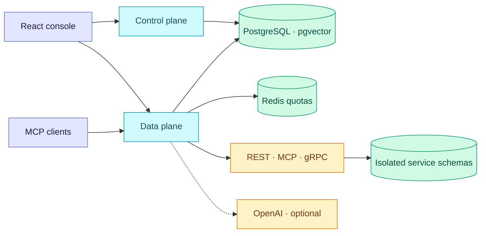

# ToolMesh AI

**An MCP gateway for discovering and running internal tools under one access policy.**

ToolMesh connects agents to REST, MCP, and gRPC services through a versioned tool catalog. It runs locally with Docker Compose and includes an operations console, scripted agent workflows, and an optional OpenAI Playground.

[](https://github.com/NagaRamya1531-tech/ToolMesh-AI/actions/workflows/ci.yml)

## Contents

[Problem and solution](#problem-and-solution) · [See it work](#see-it-work) · [Architecture](#architecture) · [Quick start](#quick-start) · [Benchmarks](#benchmarks) · [Development](#development-and-testing) · [Repository and roadmap](#repository-and-roadmap)

## Problem and solution

An agent investigating a duplicate payment needs to read payment records and open a support ticket. Issuing the refund requires a separate permission and a human approval. As teams add services, each agent integration has to keep up with different protocols, changing schemas, and rules about which customers and actions it can access. Giving the model every schema adds context without settling those access questions.

ToolMesh puts the catalog and the execution checks behind one gateway.

| Problem | How ToolMesh handles it |
|---|---|
| Finding the right tool as the catalog grows | Discovery ranks tools the caller can access. The client fetches the selected tool’s schema on demand. |
| Service contracts change independently | The crawler stages drafts. The registry preserves immutable versions and exposes the version approved for use. |
| A model can suggest an action outside its permissions | The gateway checks identity, customer scope, policy, tool version, and arguments before dispatch. Refunds and simulated restarts require a separate approval. |
| A request times out after a possible write | The execution records an uncertain outcome. For approval-gated writes, reconciliation checks the owning service’s receipt before confirming success. |

## See it work


[Registry inspector](docs/screenshots/m8-registry-inspector.png) · [Mobile agent management](docs/screenshots/m8-agents-mobile.png) · [Evaluation workspace](docs/screenshots/m8-evaluation-workspace.png) · [Live OpenAI Playground](docs/screenshots/m8-playground.png)

The sandbox duplicate-payment workflow runs across Payments, Support, and Communication using synthetic records.

1. **Support** checks order `O-102`, finds the two captures, and opens a ticket with the evidence.
2. **Finance** requests a refund for one capture. The request binds the transaction, amount, currency, and tool version.
3. **An authorized reviewer** approves the request. The gateway rechecks policy, dispatches the write, and records its outcome.
4. **Support** checks the refund receipt, records a simulated notification, and resolves the ticket. The console shows the persisted execution and approval history.

[Run this workflow](docs/runbook.md#run-the-duplicate-payment-workflow) · [Invoke a single tool](docs/runbook.md#invoke-a-single-tool) · [Try the four scripted profiles](docs/runbook.md#run-scripted-agent-scenarios)

## Architecture



The **control plane** manages registration, discovery jobs, publication, and policy. The **data plane** serves discovery and execution through REST and MCP. They run in one gateway process and share PostgreSQL for transactional catalog and execution records. Domain services keep separate schemas and database roles.

| Technology | Role |
|---|---|
| FastAPI and FastMCP | REST endpoints and native MCP Streamable HTTP share the same execution boundary. |
| PostgreSQL and pgvector | Store catalog versions, scoped policies, approvals, traces, and searchable embeddings. |
| Redis | Enforce fixed-window invocation quotas. |
| React, TypeScript, and Docker Compose | Provide a typed operations console and reproducible local setup. |
| Prometheus and optional OpenTelemetry export | Expose gateway metrics and correlate requests with execution evidence. |

[Standalone diagram](docs/diagrams/gateway.svg) · [Control plane, data plane, sequences, ERDs, and deployment](docs/architecture.md) · [Architecture decisions](docs/adr/README.md) · [Threat model](docs/threat-model.md) · [Incident procedures](docs/runbook.md#inspect-an-execution-and-its-telemetry)

## Quick start

Install Docker with the Compose v2 plugin. From the repository root:

```sh
cp -n .env.example .env
docker compose config --quiet
docker compose up --build -d --wait
curl -fsS http://127.0.0.1:8000/readyz
```

Open the [console](http://127.0.0.1:5173), [REST API contract](http://127.0.0.1:8000/docs), or [MCP Streamable HTTP endpoint](http://127.0.0.1:8000/mcp/). Sign in as `platform-admin` with the value of `TOOLMESH_ADMIN_PASSWORD` in your local `.env`. Start with the [single-tool walkthrough](docs/runbook.md#invoke-a-single-tool) or try the [approval-gated refund workflow](docs/runbook.md#run-the-duplicate-payment-workflow). The [scripted profile walkthrough](docs/runbook.md#run-scripted-agent-scenarios) covers Support, Finance, IT, and HR.

The one-shot Alembic job provisions pgvector, the workspace, isolated domain schemas, and deterministic synthetic fixtures. It exits before the API and domain services start. The console and gateway bind to loopback. Shutdown with `docker compose down` preserves PostgreSQL data.

On upgrade, merge new keys from `.env.example` into the existing `.env`. Preserve database passwords unless you also update the database roles. The [runbook](docs/runbook.md) covers bootstrap failures, Redis outages, and the refund timeout reproduction.

### Enable local embeddings

Keyword retrieval works with the base stack. Vector and hybrid retrieval and evaluation runs use a pinned, checksum-verified model. Provision it explicitly using Python 3.12 and uv:

```sh
uv sync --locked --python 3.12
HF_HUB_DISABLE_XET=1 uv run --locked python -m gateway.embeddings --output .models/discovery
docker compose restart api
```

The weights stay in the ignored local model directory and are mounted read-only. The gateway reports missing model or index state explicitly for semantic searches.

## OpenAI Playground

Open **Playground → OpenAI provider** to run one published read with the signed-in identity. The console shows the selected tool, result, trace, reported tokens, and estimated cost. Manual tools and the scripted scenarios remain available.

To enable the optional server-side provider, add this reference to your ignored root `.env` after setting `OPENAI_API_KEY`, then recreate the API container.

```dotenv
TOOLMESH_OPENAI_API_KEY=${OPENAI_API_KEY}
```

```sh
docker compose up --build -d api web
```

Use synthetic prompts and provide a catalog search for narrower selection. The gateway sends the prompt and up to eight authorized read schemas to OpenAI. It injects customer scope, revalidates the session, and validates the selected version and arguments before dispatch. Read results and execution evidence stay with the gateway and console. [Provider sequence and boundaries](docs/architecture.md#openai-playground)

## Benchmarks

| Experiment | Measured result | Evidence |
|---|---|---|
| Retrieval with 10,000 synthetic definitions and 1,000 labeled cases | Recall@5 reached 71.2% for keyword, 81.7% for vector, and 89.5% for hybrid. Hybrid SQL p95 was 231.01 ms. | [Method](docs/discovery-evaluation.md) · [Raw cases](benchmarks/results/m4-seed42-10000x1000.json.gz) |
| Warm burst of 100 authenticated hybrid searches | 100 HTTP 200 responses with 567.08 ms client p95. | [Release report](docs/release-validation.md) · [Raw samples](benchmarks/results/m7-local-release.json) |
| GPT-5.4 mini on four sandbox reads across four retrieval strategies | 16 of 16 passed after publishing the missing IT health contract. Estimated inference cost was $0.00604 USD. | [Corrected comparison](docs/release-validation.md#m8-corrected-provider-validation) · [Raw results](benchmarks/results/m8-openai-corrected.json) |
| Local Payments outage and recovery | 20 healthy reads completed at concurrency four. The fault test recorded six retries before the circuit opened and verified fail-closed Redis quota behavior. | [Method and raw samples](docs/operations-rehearsal.md) |

All measurements come from local sandbox experiments. Hybrid fell short of the 95% retrieval target on the 10,000-definition corpus. All strategies returned candidates for every negative case in that run. The load result covers one warm burst, and the provider comparison covers four synthetic tasks.

## Development and testing

Use Python 3.12, uv, Node.js 22, npm, and Docker Compose. Provision the pinned model for semantic retrieval tests. Integration and browser runs modify sandbox fixtures, so use a separate disposable Compose project with a fresh database volume for each suite. Stop any stack occupying the default ports first. Use a new project name for subsequent fresh runs.

```sh
uv sync --locked --python 3.12
uv run --locked ruff check .
uv run --locked ruff format --check .
uv run --locked mypy gateway control_plane shared services benchmarks
HF_HUB_DISABLE_XET=1 uv run --locked python -m gateway.embeddings --output .models/discovery

npm --prefix apps/web ci
npm --prefix apps/web run build
(cd apps/web && npx playwright install chromium)

docker compose -p toolmesh-doccheck up --build -d --wait
docker compose -p toolmesh-doccheck run --rm migrate
TOOLMESH_EXPECT_DRAFT=1 npm --prefix apps/web run test:e2e -- overview.spec.ts workspace.spec.ts provider.spec.ts sidebar.spec.ts
npm --prefix apps/web run test:e2e -- refund.spec.ts crawler.spec.ts
npm --prefix apps/web run test:e2e -- evaluations.spec.ts
npm --prefix apps/web run test:e2e -- access.spec.ts
docker compose -p toolmesh-doccheck down
docker compose -p toolmesh-pycheck up --build -d --wait
TOOLMESH_TEST_API=http://127.0.0.1:8000 TOOLMESH_TEST_REQUIRE_MODEL=1 TOOLMESH_TEST_MUTATE_POLICY=1 TOOLMESH_TEST_COMPOSE_PROJECT=toolmesh-pycheck uv run --locked pytest -q
docker compose -p toolmesh-pycheck down
```

For standalone Python checks, run `uv run --locked pytest -q` without setting `TOOLMESH_TEST_API`. Set `TOOLMESH_TEST_WEB` and `TOOLMESH_TEST_API` when choosing alternate host ports. The [CI workflow](.github/workflows/ci.yml) records the expected verification steps, including the secret scan. [Milestone documentation checklist](docs/contributing.md#milestone-definition-of-done)

## Repository and roadmap

| Path | Responsibility |
|---|---|
| [`gateway/`](gateway/) | Authentication, discovery, runtime dispatch, approvals, and provider Playground |
| [`control_plane/`](control_plane/) | Catalog, registered targets, crawler, and release lifecycle |
| [`services/`](services/) and [`shared/`](shared/) | Domain adapters, tool contracts, and Protobuf definitions |
| [`db/migrations/`](db/migrations/) and [`infra/`](infra/) | Database, sandbox fixtures, and container images |
| [`apps/web/`](apps/web/) and [`tests/`](tests/) | Console, browser workflows, and Python integration checks |
| [`benchmarks/`](benchmarks/) | Evaluation harness, synthetic fixtures, and raw results |

| Status | Scope |
|---|---|
| Implemented through M8 | Scoped discovery and execution, versioned contracts, 36 specified business tools, approval and receipt reconciliation, console, telemetry, and single-read OpenAI Playground |
| Planned | Multi-step model workflows, production identity, multi-tenant isolation, high availability, and sustained capacity validation |

The supported deployment is a single local Compose sandbox. Payments, restarts, and messages use synthetic fixtures. Crawling is limited to configured targets. Circuit state is local to a gateway process, and an ordinary write with an uncertain result requires operator review.

[Milestone history](CHANGELOG.md) · [Sandbox release v0.1.0](https://github.com/NagaRamya1531-tech/ToolMesh-AI/tree/v0.1.0) · [Product specification](docs/ToolMesh_AI_SRS.md)
