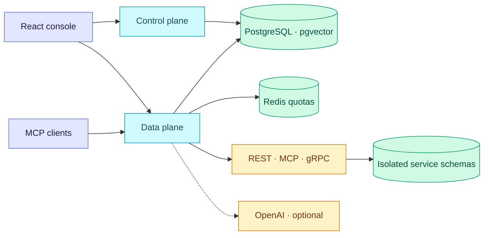

# ToolMesh AI

ToolMesh AI is a local-first MCP gateway for discovering and invoking internal service operations under explicit access policy. The repository currently implements milestones **M0 through M8**. The sandbox connects actual REST, MCP, and gRPC services to an operations console and includes scripted LangGraph profiles, scoped policy administration, and a reproducible retrieval benchmark. [Sandbox release v0.1.0](https://github.com/NagaRamya1531-tech/ToolMesh-AI/tree/v0.1.0)

[](https://github.com/NagaRamya1531-tech/ToolMesh-AI/actions/workflows/ci.yml)

**Explore the project** · [Run locally](#quick-start) · [See the architecture](#architecture) · [OpenAI Playground](#openai-playground) · [Measured results](#benchmarks)

## Contents

- [Problem and approach](#problem-and-approach)
- [Quick start](#quick-start)
- [Architecture](#architecture)
- [Security and approvals](#security-and-approvals)
- [Operations console](#operations-console)
- [OpenAI Playground](#openai-playground)
- [Reliability and operations](#reliability-and-operations)
- [Benchmarks](#benchmarks)
- [Release validation](docs/release-validation.md)
- [Development and testing](#development-and-testing)
- [Repository layout](#repository-layout)
- [Roadmap](#roadmap)
- [Limitations](#limitations)

## Problem and approach

Internal agents need to find the right operation across APIs that use different protocols, schema conventions, and access rules. Loading the full tool catalog into each request consumes context and exposes capabilities the caller may never use. Connecting directly to individual services also distributes the responsibility for authorization, version compatibility, and execution evidence.

ToolMesh publishes reviewed contracts in a versioned registry. An authenticated client discovers eligible operations, fetches a schema on demand, and invokes the selected version through the gateway. The gateway enforces service, operation, and customer scope before dispatch. Sensitive sandbox refunds require a separate human decision and produce a persisted receipt and audit trail.

## Quick start

Install Docker with the Compose v2 plugin. From the repository root:

```sh
cp -n .env.example .env
docker compose config --quiet
docker compose up --build -d --wait
curl -fsS http://127.0.0.1:8000/readyz
```

Open the [console](http://127.0.0.1:5173), [REST API contract](http://127.0.0.1:8000/docs), or [MCP Streamable HTTP endpoint](http://127.0.0.1:8000/mcp/). Sign in as `platform-admin` with the value of `TOOLMESH_ADMIN_PASSWORD` in your local `.env`. Start with the [single-tool walkthrough](docs/runbook.md#invoke-a-single-tool) or try the [approval-gated refund workflow](docs/runbook.md#run-the-duplicate-payment-workflow). The [scripted profile walkthrough](docs/runbook.md#run-scripted-agent-scenarios) covers Support, Finance, IT, and HR.

The one-shot Alembic job provisions pgvector, the workspace, isolated domain schemas, and deterministic synthetic fixtures. It exits before the API and domain services start. The console and gateway bind to loopback. Shutdown with `docker compose down` preserves PostgreSQL data.

On upgrade, merge new keys from `.env.example` into the existing `.env`. Preserve database passwords unless you also update the database roles. The [runbook](docs/runbook.md) covers bootstrap failures, Redis outages, and the refund timeout reproduction.

### Enable local embeddings

Keyword retrieval works with the base stack. Vector and hybrid retrieval and evaluation runs use a pinned, checksum-verified model. Provision it explicitly using Python 3.12 and uv:

```sh
uv sync --locked --python 3.12
HF_HUB_DISABLE_XET=1 uv run --locked python -m gateway.embeddings --output .models/discovery
docker compose restart api
```

The weights stay in the ignored local model directory and are mounted read-only. The gateway reports missing model or index state explicitly for semantic searches.

## Architecture

The control plane and data plane run in one gateway process. Their modules have distinct responsibilities and share PostgreSQL where registry and execution changes must be transactional.

> **Diagram key** · Indigo clients · Cyan gateway planes · Green state · Amber integrations



[Open the standalone architecture SVG](docs/diagrams/gateway.svg) · [Editable Mermaid source](docs/diagrams/gateway.mmd)

| Layer | Responsibility |
|---|---|
| Control plane | Allowlisted registration and crawling, immutable draft contracts, review, publication, quarantine, rollback, and evaluation jobs |
| Data plane | Authenticated discovery and invocation, active-version and scope checks, input validation, quotas, dispatch, and execution records |
| Domain services | Payments and Inventory over REST, Support and Communication over native MCP, and IT Operations over gRPC |

[Control and data plane diagrams, request sequences, ER diagrams, and deployment](docs/architecture.md) · [Architecture decisions](docs/adr/README.md)

## Security and approvals

The gateway uses expiring opaque sandbox sessions, versioned allow and deny rules, and operation and customer scope checks. Agent credentials are hashed and shown once at creation. Administrators can revoke sessions by disabling an agent. Ranking runs over the authorized active catalog. The crawler accepts configured targets, checks resolved addresses, and pins the connection address. Domain services have separate credentials and PostgreSQL roles.

Finance refund requests and IT restart requests bind exact intent and use idempotency keys. A different actor with the approver grant reviews the bound operation, customer, target, and tool version. Refund intent also includes currency and amount. The gateway records the decision atomically, rechecks authorization and dispatches the approved write. After an uncertain response, a background worker reads the owning service's receipt and confirms success only when it matches.

[Authorization, approval, and recovery diagrams](docs/architecture.md#refund-approval) · [Threat model](docs/threat-model.md)

## Operations console

The following screenshots come from running Compose sandboxes and show synthetic fixtures or actual recorded evaluation results. Sidebar sections carry their own accents into the page headers. Selecting a record opens an inspector beside the list on wide screens and below it on smaller screens.


[Registry inspector](docs/screenshots/m8-registry-inspector.png) · [Mobile agent management](docs/screenshots/m8-agents-mobile.png) · [Evaluation workspace](docs/screenshots/m8-evaluation-workspace.png) · [Mobile overview](docs/screenshots/m8-overview-mobile.png) · [OpenAI Playground](docs/screenshots/m8-playground.png) · [Mobile Playground](docs/screenshots/m8-playground-mobile.png) · [AutoCrawler](docs/screenshots/m3-crawler.png) · [Registry](docs/screenshots/m1-registry.png) · [Refund approval](docs/screenshots/m2-approval.png) · [Resolved workflow](docs/screenshots/m2-workflow.png) · [Evaluations](docs/screenshots/m4-evaluations.png) · [Policies](docs/screenshots/m5-policies.png) · [Finance scenario](docs/screenshots/m5-scenario.png) · [Execution timeline](docs/screenshots/m6-executions.png) · [Mobile execution timeline](docs/screenshots/m6-executions-mobile.png) · [Release evaluation smoke test](docs/screenshots/m7-evaluations.png)

## OpenAI Playground

Open **Playground → OpenAI provider** to run one published read with the signed-in identity. The console shows the selected tool, result, trace, reported tokens, and estimated cost. Manual tools and the scripted scenarios remain available.

To enable the optional server-side provider, add this reference to your ignored root `.env` after setting `OPENAI_API_KEY`, then recreate the API container.

```dotenv
TOOLMESH_OPENAI_API_KEY=${OPENAI_API_KEY}
```

```sh
docker compose up --build -d api web
```

Use synthetic prompts and provide a catalog search for narrower selection. The gateway sends the prompt and up to eight authorized read schemas to OpenAI. It injects customer scope, revalidates the session, and validates the selected version and arguments before dispatch. Read results and execution evidence stay with the gateway and console. [Provider sequence and boundaries](docs/architecture.md#openai-playground)

## Reliability and operations

PostgreSQL records execution timelines with request and OpenTelemetry trace IDs. The console and CLI show these events to callers who can view the corresponding execution. Gateway telemetry is available on a private Prometheus endpoint and supports optional OTLP HTTP export. Ordinary reads retry recognized transient faults within seven seconds and use a per-service circuit breaker. The gateway dispatches writes once and classifies stale writes as uncertain when it cannot prove their outcome. [CLI and incident procedures](docs/runbook.md#inspect-an-execution-and-its-telemetry)

## Benchmarks

The M4 held-out run used **10,000 synthetic definitions and 1,000 labeled cases**, with seed 42. Benchmark definitions live outside the executable registry.

| Strategy | Recall@5 | MRR | SQL p95 |
|---|---:|---:|---:|
| Keyword | 71.2% | 0.586 | 69.25 ms |
| Vector | 81.7% | 0.731 | 203.17 ms |
| Hybrid | 89.5% | 0.738 | 231.01 ms |

Hybrid had the highest recall and fell short of the 95% target. All three strategies returned candidates for all 400 negative cases. Ranked results alone cannot establish whether a suitable tool exists. These timings cover local PostgreSQL query round trips. Agent latency, provider token counts, and task success are outside this experiment.

[Methodology, environment, and reproduction commands](docs/discovery-evaluation.md) · [Raw case export](benchmarks/results/m4-seed42-10000x1000.json.gz)

The M6 local operations rehearsal completed 20 Payments reads in batches of four. Client-side median latency was 38.83 ms and nearest-rank p95 was 153.71 ms. The fault run measured six retries before the circuit opened and verified fail-closed Redis quota behavior. [Operations methodology and limitations](docs/operations-rehearsal.md) · [Raw samples](benchmarks/results/m6-local-operations.json)

M7 measured 94.4% hybrid Recall@5 on 1,000 synthetic definitions and 120 labeled cases. Gemma 2B completed two of four read cases with each ranked strategy and zero with upfront schemas. A warm burst of 100 authenticated hybrid searches returned 100 HTTP 200 responses with 567.08 ms client p95. [Release methodology, raw evidence, and limitations](docs/release-validation.md)

M8 verified all four synthetic reads with each strategy after publishing the missing IT health contract. The 16-request OpenAI benchmark cost an estimated $0.00604 USD. [Corrected comparison and raw evidence](docs/release-validation.md#m8-corrected-provider-validation)

## Development and testing

Use Python 3.12, uv, Node.js 22, npm, and Docker Compose. Provision the pinned model for semantic retrieval tests. Integration and browser runs modify sandbox fixtures, so use a separate disposable Compose project with a fresh database volume for each suite. Stop any stack occupying the default ports first. Use a new project name for subsequent fresh runs.

```sh
uv sync --locked --python 3.12
uv run --locked ruff check .
uv run --locked ruff format --check .
uv run --locked mypy gateway control_plane shared services benchmarks
HF_HUB_DISABLE_XET=1 uv run --locked python -m gateway.embeddings --output .models/discovery

npm --prefix apps/web ci
npm --prefix apps/web run build
(cd apps/web && npx playwright install chromium)

docker compose -p toolmesh-doccheck up --build -d --wait
docker compose -p toolmesh-doccheck run --rm migrate
TOOLMESH_EXPECT_DRAFT=1 npm --prefix apps/web run test:e2e -- overview.spec.ts workspace.spec.ts provider.spec.ts sidebar.spec.ts
npm --prefix apps/web run test:e2e -- refund.spec.ts crawler.spec.ts
npm --prefix apps/web run test:e2e -- evaluations.spec.ts
npm --prefix apps/web run test:e2e -- access.spec.ts
docker compose -p toolmesh-doccheck down
docker compose -p toolmesh-pycheck up --build -d --wait
TOOLMESH_TEST_API=http://127.0.0.1:8000 TOOLMESH_TEST_REQUIRE_MODEL=1 TOOLMESH_TEST_MUTATE_POLICY=1 TOOLMESH_TEST_COMPOSE_PROJECT=toolmesh-pycheck uv run --locked pytest -q
docker compose -p toolmesh-pycheck down
```

For standalone Python checks, run `uv run --locked pytest -q` without setting `TOOLMESH_TEST_API`. Set `TOOLMESH_TEST_WEB` and `TOOLMESH_TEST_API` when choosing alternate host ports. The [CI workflow](.github/workflows/ci.yml) records the expected verification steps, including the secret scan. [Milestone documentation checklist](docs/contributing.md#milestone-definition-of-done)

## Repository layout

| Path | Responsibility |
|---|---|
| [`gateway/`](gateway/) | Authenticated REST and MCP entry points, invocation, approval reconciliation, scoped discovery, and scripted workflow |
| [`control_plane/`](control_plane/) | Catalog registration, release lifecycle, crawler jobs, and source translators |
| [`services/`](services/) | Payments, Support, Communication, Inventory, IT Operations, HR, and Analytics adapters and domain logic |
| [`shared/`](shared/) | Business tool contracts, SQL helpers, Protobuf descriptors, and generated gRPC stubs |
| [`db/migrations/`](db/migrations/) | Alembic schema changes, domain roles, fixtures, and permissions |
| [`apps/web/`](apps/web/) | Operations console and browser acceptance tests |
| [`benchmarks/`](benchmarks/) | Synthetic retrieval dataset, evaluation worker, operations rehearsal, and raw evidence |
| [`tests/`](tests/) | Python unit and real-service integration checks |
| [`infra/`](infra/) | Container images and PostgreSQL initialization |

## Roadmap

| Milestone | State | Scope |
|---|---|---|
| M0–M2 | Implemented | Compose foundation, authenticated runtime, Payments and Support, human refund approval, reconciliation, and simulated communication |
| M3 | Implemented | Allowlisted AutoCrawler, contract lifecycle, Inventory fixture, and three IT gRPC operations |
| M4 | Implemented | PostgreSQL keyword, vector, and hybrid retrieval and measured synthetic evaluations |
| M5 | Implemented | All 36 specified domain tools, HR and Analytics, four scripted profiles, policy revisions and simulation, and configurable quotas |
| M6 | Implemented | Execution timelines and telemetry, bounded reads, stale recovery, operator CLI, and local concurrency and fault rehearsal |
| M8 | Implemented | Opt-in OpenAI read-only Playground, provider usage and trace view, and a refreshed architecture and console |
| M7 | Implemented | Fresh-install and accessibility validation, held-out retrieval and a 100-client burst, local provider comparison, and the tagged sandbox release |

No implementation milestone is in progress at this checkpoint. [Changelog](CHANGELOG.md) · [Product specification](docs/ToolMesh_AI_SRS.md)

## Limitations

- The supported deployment is a single local Compose sandbox. Production SSO, TLS, multi-tenant isolation, and high availability are planned.
- The local sandbox implements all 36 specified business tools across six domains plus supplemental fixture and workflow tools. Publication state determines which operations are discoverable.
- Crawler targets are configured local services. Arbitrary external registration and gRPC reflection are outside the current scope.
- Agent scenarios run bounded LangGraph scripts. The local Ollama evaluation harness measures tool selection. The console supports a single OpenAI-selected read. Multi-step model workflows remain planned. Payments, restarts, and messages are simulated.
- If refund reconciliation finds no matching receipt, execution remains `UNKNOWN` for review. Restart approvals also use read-only receipt reconciliation. Ordinary writes have no automated reconciliation or write replay.
- Circuit state is per gateway process. OTLP export requires a collector, and instrumentation covers the gateway boundary. Background invocations may lack HTTP correlation IDs. Older execution rows predate the timeline. Production throughput remains unmeasured.
- Vector ranking uses exact distance over the eligible set. The negative cases still receive candidates. Sustained capacity, gateway-only overhead, and provider accuracy beyond the four labeled tasks remain unmeasured.
