<div align="center">

# ToolMesh AI

**A unified gateway for discovering and securely executing enterprise tools at scale.**

ToolMesh AI addresses tool-context overload, fragmented service integrations and unsafe agent execution through on-demand discovery, a versioned catalog and centralized enforcement.

[](https://github.com/NagaRamya1531-tech/ToolMesh-AI/actions/workflows/ci.yml)


[Problem & solution](#problem-and-solution) · [Architecture](#architecture) · [Product demo](#demo-workflow) · [Benchmarks](#benchmarks) · [Quick start](#quick-start)

</div>

## Contents

- [Problem and solution](#problem-and-solution)
- [What the system does](#what-the-system-does)
- [Architecture](#architecture)
- [Service catalog](#service-catalog)
- [Demo workflow](#demo-workflow)
- [Tool discovery and ranking](#tool-discovery-and-ranking)
- [Security and governance](#security-and-governance)
- [Operations console](#operations-console)
- [OpenAI Playground](#openai-playground)
- [Benchmarks](#benchmarks)
- [Quick start](#quick-start)
- [Development and testing](#development-and-testing)
- [Repository and roadmap](#repository-and-roadmap)
- [Limitations](#limitations)
- [Engineering documentation](#engineering-documentation)

## Problem and solution

### The engineering problem

AI agents can reason about a user's request, but they need tools to read enterprise data and perform actions. An organization may expose hundreds or thousands of operations across payment systems, support platforms, HR applications, infrastructure services and internal APIs.

Consider a support agent investigating a duplicate charge. It needs to find the relevant payment operations, retrieve the customer's transactions, open a support ticket and arrange a refund. That final action must be restricted to the right requester and approved by a separate reviewer. If a refund request times out after the payment service commits the write, retrying blindly could create another refund.

This is not merely a prompt-engineering problem. It is a **tool discovery, integration, authorization and distributed execution problem**.

| Challenge | Why it matters |
|---|---|
| Tool-context overload | Supplying every tool schema to a model increases input tokens and leaves less context for the actual task. |
| Tool selection at scale | Similar tool names and descriptions make finding the correct, eligible operation harder. |
| Fragmented integrations | Agents must otherwise maintain separate connections, protocol adapters, credentials and changing API contracts. |
| Unsafe execution | A model can request an operation that is outside its permissions or requires approval. Instructions alone cannot enforce access control. |
| Uncertain writes and limited visibility | A timeout does not prove a write failed. Operators need durable evidence and a way to reconcile uncertain outcomes. |

### Traditional integrations vs. ToolMesh

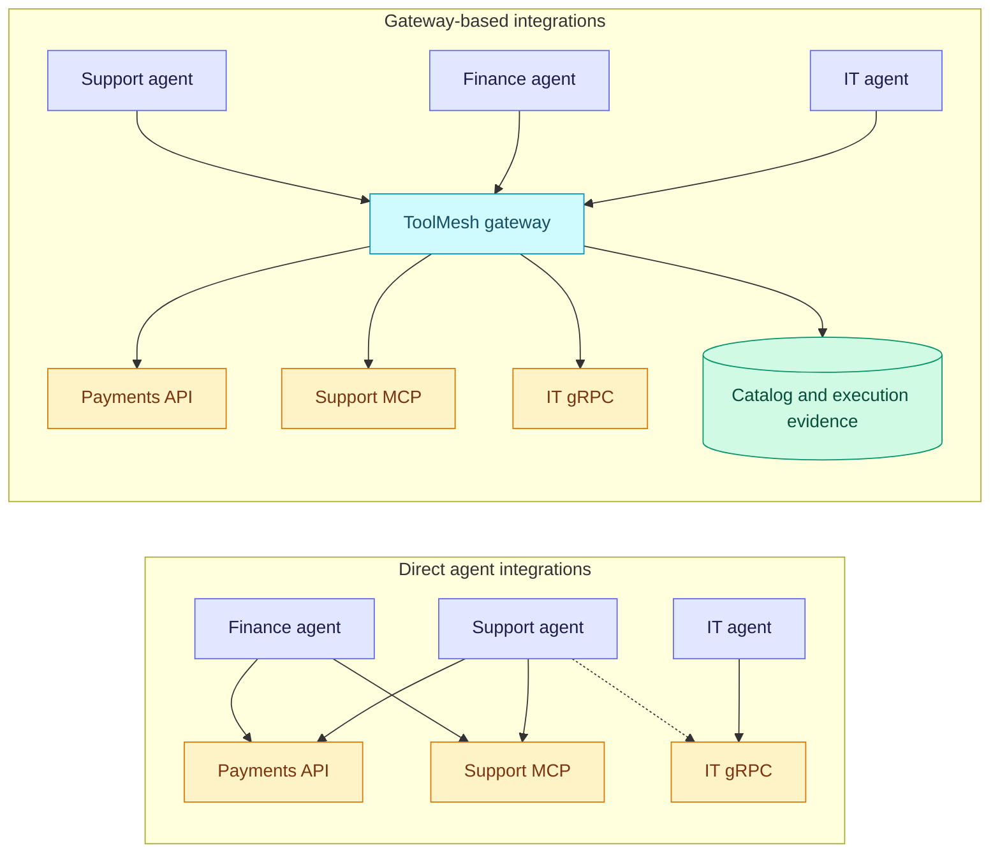

The left-hand side illustrates duplicated integration paths, not a measured production topology. The right-hand side centralizes discovery, routing and enforcement while preserving service-specific permissions.

### What ToolMesh solves

ToolMesh gives agents and developers a single gateway. Rather than loading the entire catalog, clients discover eligible services and tools, retrieve only the required schema and invoke the selected operation. The gateway, not the model, determines whether the call may proceed.

| Problem | Implemented solution |
|---|---|
| Excessive context consumption | Four gateway meta-tools and on-demand schema retrieval |
| Finding relevant operations | Permission-filtered keyword, vector and hybrid ranking |
| Multiple service protocols | Unified MCP and REST entry points with REST, MCP and gRPC adapters |
| Changing API contracts | Configured crawler, immutable schema versions, explicit publication and quarantine |
| Unauthorized or sensitive actions | Scoped identities, current grants, validated arguments, Redis quotas and separate approval for protected writes |
| Ambiguous write outcomes | Persisted execution states, idempotent refund ledger and exact receipt reconciliation |
| Operational visibility | React console, audit evidence, execution timelines and telemetry |

### Why this project exists

The goal is to build the infrastructure that lets multiple agents use enterprise tools safely and efficiently, not to build a general-purpose chatbot. The duplicate-payment workflow is a concrete test of that infrastructure: three services, distinct requester and reviewer identities, an approval-gated write and a recoverable execution trail.

The current implementation is a local sandbox. Its measured results demonstrate improvements in specific experiments, not production-scale guarantees. See [benchmarks](#benchmarks) and [limitations](#limitations).

## What the system does

ToolMesh separates agent reasoning from the system that authorizes and executes operations. It manages a versioned catalog, discovers eligible tools, validates requests against active contracts, routes them through protocol adapters, and persists execution evidence.

| Capability | Current implementation |
|---|---|
| Unified tool interface | Native MCP Streamable HTTP and REST API |
| Automated registration | Configured OpenAPI, native MCP and Protobuf sources |
| Intelligent discovery | Authorization-prefiltered keyword, vector and hybrid ranking |
| Contract lifecycle | Immutable drafts, publication, quarantine and compatible rollback |
| Governance | Scoped identities, explicit denies, Redis quotas and approvals |
| Reliability | Bounded read retries, circuit breakers, idempotent refund ledger and reconciliation |
| Agent workflows | Four scripted LangGraph profiles and optional single-read OpenAI Playground |
| Operations | React console, execution history, audit evidence and telemetry |
| Evaluation | Isolated synthetic retrieval corpus, provider comparisons and raw exports |

### Implementation at a glance

| Backend services | Integration protocols | Retrieval test corpus | Hybrid input-token reduction |
| :---: | :---: | :---: | :---: |
| **7** | **3** | **10,000 definitions** | **92.9%** |

<sub>Local Compose topology; synthetic retrieval corpus; token reduction measured on four fixed M8 tasks per strategy. See [benchmark methodology](#benchmarks).</sub>

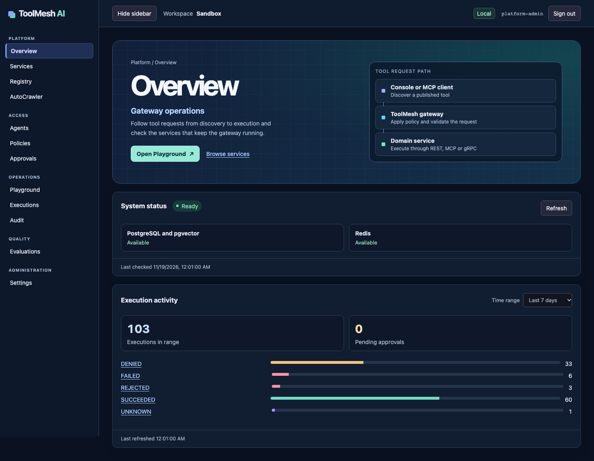

*Actual M8 sandbox console: request path, dependency health and recorded execution outcomes.*

> **Status:** Local-first implementation through M8. Business records and external side effects are simulated. Production identity, tenant isolation, high availability and unrestricted multi-step model planning remain future work.

## Architecture

### System overview

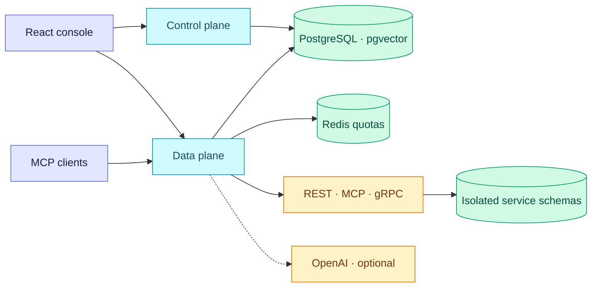

The control and data planes currently run in one FastAPI/FastMCP gateway process. Domain services run in separate containers and use separate PostgreSQL schemas and logins within one database instance. The browser and MCP clients share the runtime authorization boundary.

### Control plane

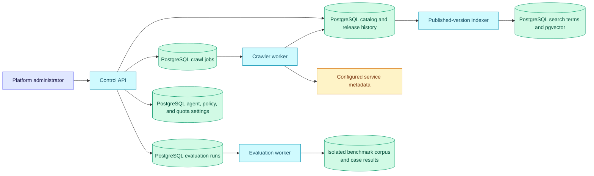

The crawler probes configured service sources and stages immutable drafts. Explicit administrator publication activates a compatible version. Breaking or missing source contracts are quarantined; unsupported operations are not automatically executable.

### Data plane

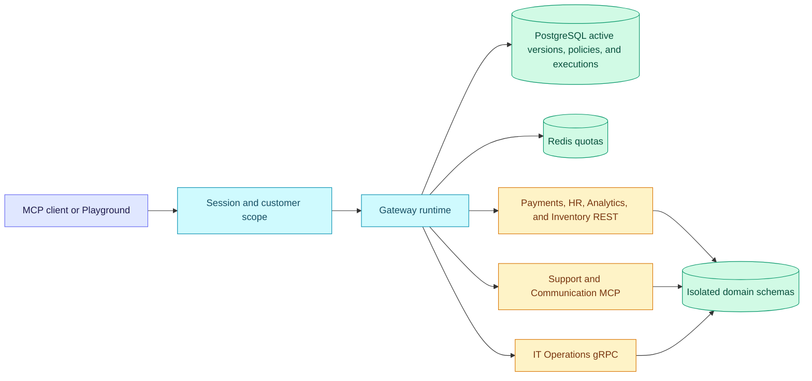

Every invocation rechecks caller scope, active version, grants, input contract and quota. REST and native MCP requests use the same runtime.

### Incremental tool discovery

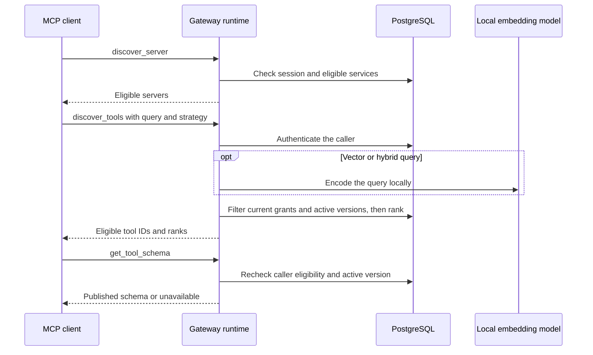

| Gateway meta-tool | Responsibility |
|---|---|
| `discover_server` | Find eligible services |
| `discover_tools` | Retrieve and rank eligible tools |
| `get_tool_schema` | Fetch a published input contract |
| `invoke_tool` | Execute a specific authorized operation |

### Tool execution

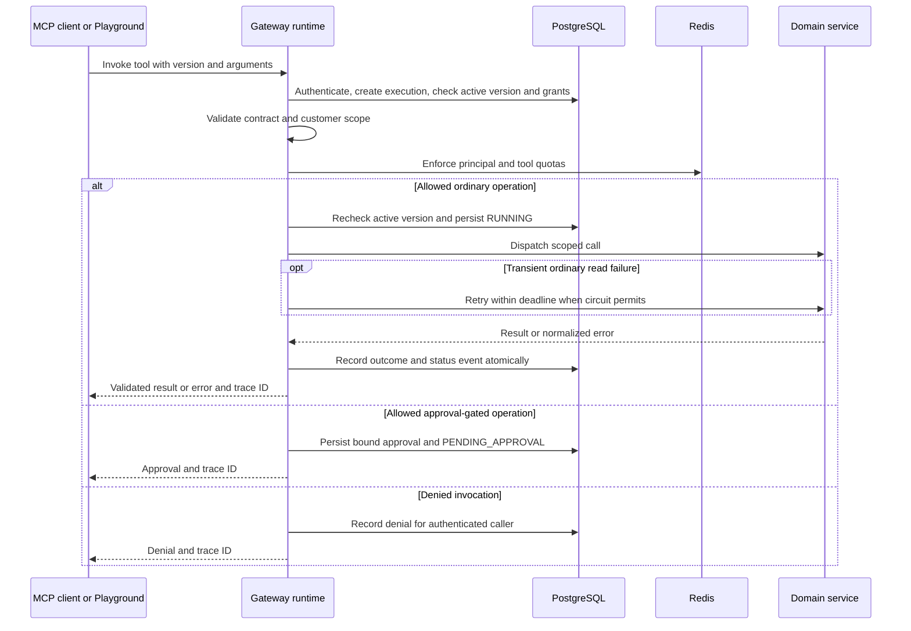

[Complete system design, database ERDs and deployment](docs/architecture.md) · [Standalone architecture diagram](docs/diagrams/gateway.svg) · [Architecture decisions](docs/adr/README.md)

## Service catalog

The local deployment includes seven independently running domain services. The six primary business domains cover the specified 36 business operations; Inventory is an additional configured crawler target. Tool availability depends on publication and caller permissions.

| Service | Protocol | Responsibility |
|---|---|---|
| Payments | REST | Transactions, duplicate charges and refund ledger |
| Customer Support | MCP | Customer records and ticket lifecycle |
| Communication | MCP | Messages and simulated notifications |
| IT Operations | gRPC | Service health, incidents and simulated restarts |
| Human Resources | REST | Employee and HR operations |
| Analytics | REST | Business metrics and reporting |
| Inventory | REST | Inventory and crawler integration |

## Demo workflow

### Duplicate-payment investigation

The guided sandbox scenario uses synthetic order `O-102` and persists real local service state. Support finds two captures and creates a ticket; Finance requests a refund; a separate approver reviews the bound intent. Support checks the receipt, records a simulated notification and resolves the ticket.


### Approval and recovery

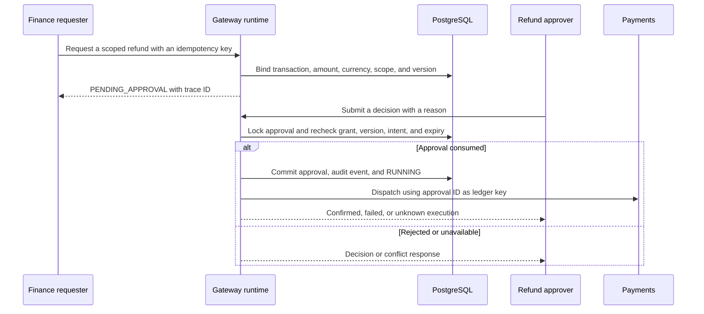

A delayed refund response can hide a successful downstream commit. The gateway records uncertainty rather than replaying a protected write.

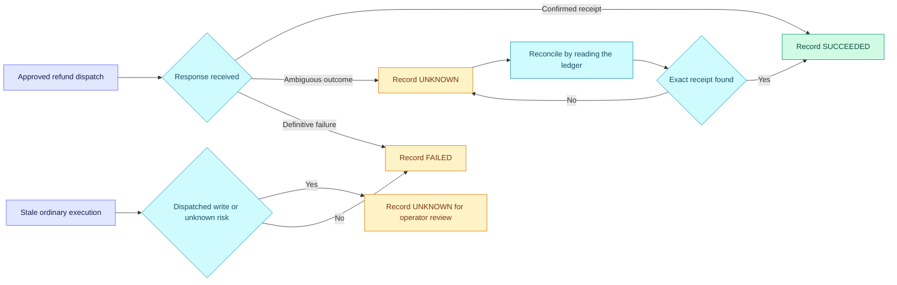

The documented rehearsal verified one logical refund under concurrent approval, followed by exact receipt reconciliation. The reconciler reads the ledger; it does not repeat the write.

[Run the duplicate-payment workflow](docs/runbook.md#run-the-duplicate-payment-workflow) · [Reproduce a timeout](docs/runbook.md#reproduce-a-timeout-after-refund-commit) · [Try the scripted agent profiles](docs/runbook.md#run-scripted-agent-scenarios)

## Tool discovery and ranking

PostgreSQL full-text search and exact pgvector cosine ranking operate on the current, authorization-filtered active catalog. The local 256-dimensional Model2Vec model supplies query embeddings. Hybrid search uses reciprocal rank fusion with a rank constant of 60 and up to 100 candidates per strategy. The evaluation corpus is separate from executable tools.

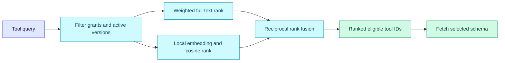

[Retrieval methodology](docs/discovery-evaluation.md) · [Authorization-prefiltered discovery ADR](docs/adr/0005-authorization-prefiltered-discovery.md)

## Security and governance

| Boundary | Enforcement |
|---|---|
| Identity | Expiring opaque session tokens, stored as hashes |
| Authorization | Profile ceilings, explicit denies, customer and employee scopes |
| Execution | Active schema and version validation, scoped routing, Redis quotas |
| Sensitive writes | Separate approver, canonical intent, expiry and single consumption |
| Data isolation | Distinct domain database roles and response redaction |
| Observability | Persistent execution events, trace and request IDs; metadata rather than raw payloads |

### Tool registration and version lifecycle

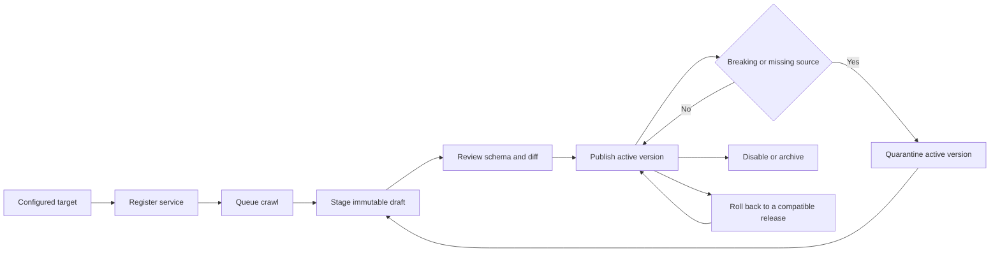

[Threat model](docs/threat-model.md) · [Database relationship diagrams](docs/architecture.md#database-relationships) · [Operational rehearsal](docs/operations-rehearsal.md)

## Operations console

### Tool registry

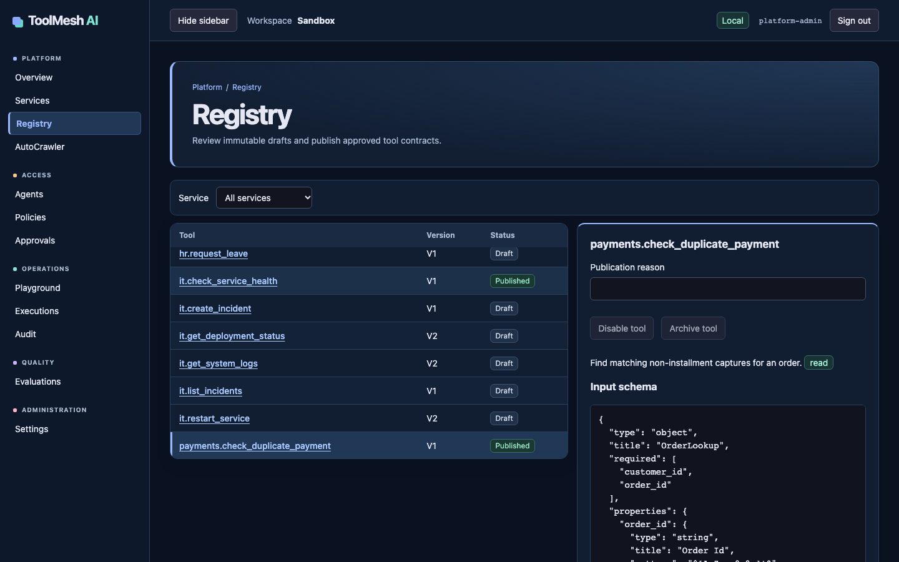

Inspect available tools, schemas and versions in a responsive record inspector.

### Agent Playground


Inspect the chosen tool, verified read result, trace, provider-reported token usage and estimated inference cost.

### Evaluation workspace


Compare discovery strategies, inspect case-level results and export evaluation evidence.

[Approval interface](docs/screenshots/m2-approval.png) · [Crawler](docs/screenshots/m3-crawler.png) · [Execution timeline](docs/screenshots/m6-executions.png) · [Mobile console](docs/screenshots/m8-overview-mobile.png)

## OpenAI Playground

Open **Playground → OpenAI provider** to run one published read with the signed-in identity. The console shows the selected tool, result, trace, reported tokens, and estimated cost. Manual tools and the scripted scenarios remain available.

To enable the optional server-side provider, add this reference to your ignored root `.env` after setting `OPENAI_API_KEY`, then recreate the API container.

```dotenv
TOOLMESH_OPENAI_API_KEY=${OPENAI_API_KEY}
```

```sh
docker compose up --build -d api web
```

Use synthetic prompts and provide a catalog search for narrower selection. The gateway sends the prompt and up to eight authorized read schemas to OpenAI. It injects customer scope, revalidates the session, and validates the selected version and arguments before dispatch. Read results and execution evidence stay with the gateway and console. [Provider sequence and boundaries](docs/architecture.md#openai-playground)

## Benchmarks

These are measured local sandbox experiments, not production SLAs. Raw evidence is committed alongside the implementation.

### Retrieval quality

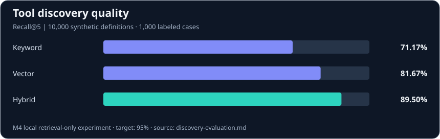

| Strategy | Recall@5 | SQL p95 |
|---|---:|---:|
| Keyword | 71.17% | 69.25 ms |
| Vector | 81.67% | 203.17 ms |
| Hybrid | **89.50%** | 231.01 ms |

The M4 run tested 10,000 generated definitions and 1,000 held-out cases. SQL latency excludes embedding and model inference. Hybrid missed the 95% recall target and all three strategies returned candidates for every negative case.

[Method and environment](docs/discovery-evaluation.md) · [Raw compressed cases](benchmarks/results/m4-seed42-10000x1000.json.gz)

### Model input tokens

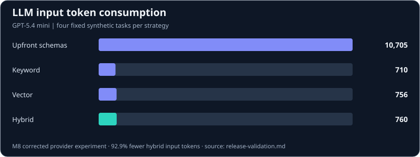

| Strategy | Verified reads | Input tokens | Output tokens |
|---|---:|---:|---:|
| Upfront schemas | 4/4 | 10,705 | 64 |
| Keyword | 4/4 | 710 | 64 |
| Vector | 4/4 | 756 | 64 |
| Hybrid | 4/4 | 760 | 70 |

The corrected M8 GPT-5.4 mini comparison used four synthetic tasks per strategy; all 16 reads were verified. Hybrid used 92.9% fewer provider-reported input tokens than upfront schemas. Estimated list-rate cost was $0.00604 for the 16 requests. This small sample does not establish general accuracy or full multi-step workflow savings.

[Corrected provider report](docs/release-validation.md#m8-corrected-provider-validation) · [Raw provider results](benchmarks/results/m8-openai-corrected.json)

### Reliability and load

| Experiment | Reported result |
|---|---|
| M7 warm discovery burst | 100 HTTP 200 responses; 567.08 ms client p95 |
| Local Payments outage | 20 healthy reads at concurrency four; fault retries and circuit opening verified |
| Redis fault | Fail-closed quota behavior verified |
| Delayed refund | One logical refund in the rehearsal; uncertain outcome reconciled |

A warm burst is not sustained capacity validation.

[Release report](docs/release-validation.md) · [Operations rehearsal](docs/operations-rehearsal.md) · [Raw load export](benchmarks/results/m7-local-release.json)

## Quick start

Install Docker with the Compose v2 plugin. From the repository root:

```sh
cp -n .env.example .env
docker compose config --quiet
docker compose up --build -d --wait
curl -fsS http://127.0.0.1:8000/readyz
```

Open the [console](http://127.0.0.1:5173), [REST API contract](http://127.0.0.1:8000/docs), or [MCP Streamable HTTP endpoint](http://127.0.0.1:8000/mcp/). Sign in as `platform-admin` with the value of `TOOLMESH_ADMIN_PASSWORD` in your local `.env`. Start with the [single-tool walkthrough](docs/runbook.md#invoke-a-single-tool) or try the [approval-gated refund workflow](docs/runbook.md#run-the-duplicate-payment-workflow). The [scripted profile walkthrough](docs/runbook.md#run-scripted-agent-scenarios) covers Support, Finance, IT, and HR.

The one-shot Alembic job provisions pgvector, the workspace, isolated domain schemas, and deterministic synthetic fixtures. It exits before the API and domain services start. The console and gateway bind to loopback. Shutdown with `docker compose down` preserves PostgreSQL data.

On upgrade, merge new keys from `.env.example` into the existing `.env`. Preserve database passwords unless you also update the database roles. The [runbook](docs/runbook.md) covers bootstrap failures, Redis outages, and the refund timeout reproduction.

### Enable local embeddings

Keyword retrieval works with the base stack. Vector and hybrid retrieval and evaluation runs use a pinned, checksum-verified model. Provision it explicitly using Python 3.12 and uv:

```sh
uv sync --locked --python 3.12
HF_HUB_DISABLE_XET=1 uv run --locked python -m gateway.embeddings --output .models/discovery
docker compose restart api
```

The weights stay in the ignored local model directory and are mounted read-only. The gateway reports missing model or index state explicitly for semantic searches.

## Development and testing

Python 3.12, uv, Node.js 22, npm and Docker Compose are required. The M8 changelog reports 25 Python tests, 12 standard Chromium tests and one live provider Chromium test passing, along with lint, typing and production-build checks.

<details>
<summary>Full verification commands</summary>

Use Python 3.12, uv, Node.js 22, npm, and Docker Compose. Provision the pinned model for semantic retrieval tests. Integration and browser runs modify sandbox fixtures, so use a separate disposable Compose project with a fresh database volume for each suite. Stop any stack occupying the default ports first. Use a new project name for subsequent fresh runs.

```sh
uv sync --locked --python 3.12
uv run --locked ruff check .
uv run --locked ruff format --check .
uv run --locked mypy gateway control_plane shared services benchmarks
HF_HUB_DISABLE_XET=1 uv run --locked python -m gateway.embeddings --output .models/discovery

npm --prefix apps/web ci
npm --prefix apps/web run build
(cd apps/web && npx playwright install chromium)

docker compose -p toolmesh-doccheck up --build -d --wait
docker compose -p toolmesh-doccheck run --rm migrate
TOOLMESH_EXPECT_DRAFT=1 npm --prefix apps/web run test:e2e -- overview.spec.ts workspace.spec.ts provider.spec.ts sidebar.spec.ts
npm --prefix apps/web run test:e2e -- refund.spec.ts crawler.spec.ts
npm --prefix apps/web run test:e2e -- evaluations.spec.ts
npm --prefix apps/web run test:e2e -- access.spec.ts
docker compose -p toolmesh-doccheck down
docker compose -p toolmesh-pycheck up --build -d --wait
TOOLMESH_TEST_API=http://127.0.0.1:8000 TOOLMESH_TEST_REQUIRE_MODEL=1 TOOLMESH_TEST_MUTATE_POLICY=1 TOOLMESH_TEST_COMPOSE_PROJECT=toolmesh-pycheck uv run --locked pytest -q
docker compose -p toolmesh-pycheck down
```

For standalone Python checks, run `uv run --locked pytest -q` without setting `TOOLMESH_TEST_API`. Set `TOOLMESH_TEST_WEB` and `TOOLMESH_TEST_API` when choosing alternate host ports. The [CI workflow](.github/workflows/ci.yml) records the expected verification steps, including the secret scan. [Milestone documentation checklist](docs/contributing.md#milestone-definition-of-done)

</details>

## Repository and roadmap

```text
ToolMesh-AI/
├── gateway/           # Shared invocation boundary, discovery, access and recovery
├── control_plane/     # Crawler, catalog, governance and schema management
├── services/          # Independent domain services and adapters
├── shared/            # Typed contracts, database helpers, Protobuf
├── db/migrations/     # Alembic schema evolution and fixtures
├── apps/web/          # React operations console and browser tests
├── benchmarks/        # Evaluation harness and committed raw evidence
├── tests/             # Python unit and integration checks
├── infra/             # Container and database initialization
├── docs/              # Architecture, ADRs, runbooks and screenshots
├── .github/workflows/ # Continuous integration
└── compose.yaml       # Local deployment topology
```

| Milestone | Capability | Status |
|---|---|---|
| M0–M1 | Foundation, gateway and initial services | Implemented |
| M2 | Approval and guided refund workflow | Implemented |
| M3 | Registry, crawler and gRPC | Implemented |
| M4 | Ranked discovery and evaluation | Implemented |
| M5 | Domain tools, policies and scripted profiles | Implemented |
| M6 | Reliability, telemetry and execution evidence | Implemented |
| M7 | Local sandbox release and benchmarks | Implemented |
| M8 | Console refresh and read-only OpenAI Playground | Implemented |
| Future | Multi-step model workflows, production identity, tenant isolation, HA and sustained load validation | Planned |

### Technology choices

| Technology | Engineering rationale |
|---|---|
| FastAPI + FastMCP | A shared invocation boundary for REST and native MCP |
| PostgreSQL + Alembic | Transactional catalog, approvals, execution evidence and explicit migrations |
| pgvector + Model2Vec | CPU-friendly local embedding retrieval alongside full-text search |
| Redis | Shared fixed-window invocation quotas |
| LangGraph | Bounded scripted profiles using persisted gateway state |
| React + TypeScript | Typed operations console and browser-tested workflows |
| Prometheus + OpenTelemetry | Metrics and optional distributed trace export |
| Docker Compose | Reproducible local service topology |

## Limitations

- Single local gateway process and Compose sandbox, not a production distributed deployment.
- Domain data and external side effects are synthetic.
- Crawler targets and adapter operations are configured, not arbitrary network discovery.
- Circuit state is process-local; uncertain ordinary writes require operator review.
- OpenAI Playground is single-read; scripted profiles are not unrestricted model planning.
- Retrieval accuracy, negative-query abstention and sustained capacity need further validation.

## Engineering documentation

| Document | Content |
|---|---|
| [Architecture](docs/architecture.md) | Detailed planes, sequences, data model and deployment |
| [Architecture decision records](docs/adr/README.md) | Design choices and tradeoffs |
| [Threat model](docs/threat-model.md) | Security boundaries |
| [Runbook](docs/runbook.md) | Setup, walkthroughs and incident procedures |
| [Discovery evaluation](docs/discovery-evaluation.md) | Retrieval methodology and results |
| [Release validation](docs/release-validation.md) | Provider, load and end-to-end evidence |
| [Operations rehearsal](docs/operations-rehearsal.md) | Fault injection and recovery |
| [Changelog](CHANGELOG.md) | Milestone history and verification |
| [Product specification](docs/ToolMesh_AI_SRS.md) | Original requirements and intended scope |

Inspired by Uber's public MCP gateway design and the [Model Context Protocol](https://modelcontextprotocol.io/). Independent implementation; no Uber internal services or infrastructure are used.
