<div align="center">

# ToolMesh AI

**One MCP gateway for discovering and running internal tools under explicit access policy.**

ToolMesh connects REST, MCP, and gRPC services to a versioned tool catalog. Agents retrieve schemas on demand, and operators review decisions and execution traces in the console.

[](https://github.com/NagaRamya1531-tech/ToolMesh-AI/actions/workflows/ci.yml)


[Architecture](#architecture) · [Demo workflow](#demo-workflow) · [Quick start](#quick-start) · [Benchmarks](#benchmarks) · [Engineering docs](#engineering-documentation)

</div>


*The local operations console shows the request path, live dependency health, and recorded sandbox outcomes.*

**Current scope:** Local Docker Compose sandbox with active capabilities through M8. M9.1.1–M9.1.3 add protected-execution storage and approval transactions for future integration. Payments, restarts, and notifications use synthetic records.

## Contents

- [Problem and solution](#problem-and-solution)
- [Architecture](#architecture)
- [Demo workflow](#demo-workflow)
- [Tool discovery and ranking](#tool-discovery-and-ranking)
- [Security and governance](#security-and-governance)
- [Service catalog](#service-catalog)
- [Operations console](#operations-console)
- [OpenAI Playground](#openai-playground)
- [Benchmarks](#benchmarks)
- [Quick start](#quick-start)
- [Repository and roadmap](#repository-and-roadmap)
- [Development and testing](#development-and-testing)
- [Engineering tradeoffs](#engineering-tradeoffs)
- [Limitations](#limitations)
- [Engineering documentation](#engineering-documentation)

## Problem and solution

A support agent investigating a duplicate charge needs payment records and a support ticket. Refunding the charge takes a different permission and an independent approval. As more services are added, every agent integration must account for protocol differences, changing schemas, customer scope, and how to recover when a write may have taken effect.

ToolMesh puts those decisions in one gateway. An agent discovers the operations its identity can see, fetches the published schema when needed, and invokes a pinned version. The gateway checks access and arguments before dispatch. Approval and execution records let an operator see who requested an action, which version ran, and whether a receipt confirmed the outcome.

| Integration challenge | Gateway response |
|---|---|
| Large tool catalogs add model context | Retrieve eligible candidates first, then fetch the chosen schema. |
| Services use different protocols and release independently | Keep a published contract catalog and route through REST, MCP, and gRPC adapters. |
| Calls cross permission boundaries | Enforce current grants, object scope, quotas, and independent approval for protected writes. |
| A write may commit before the caller receives a response | Preserve the execution state and reconcile approval-gated writes against the downstream receipt. |

## Architecture

The control and data planes run in one FastAPI and FastMCP process. PostgreSQL coordinates catalog, approval, and execution state. Domain containers have separate PostgreSQL schemas and logins. The optional OpenAI path works through the same runtime boundary.

Indigo denotes clients, cyan denotes gateway components, green denotes stored state, and amber denotes integrations.

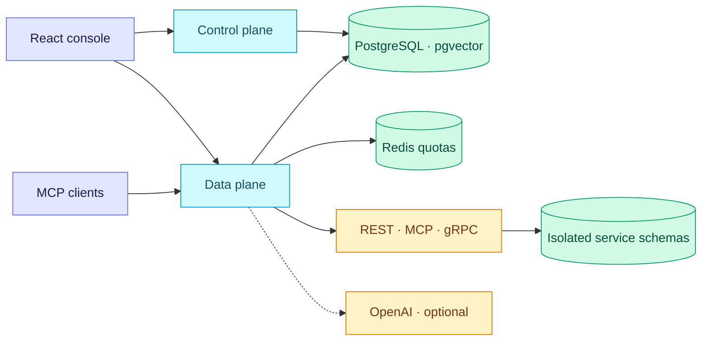

[Standalone architecture SVG](docs/diagrams/gateway.svg) · [Deployment and ER diagrams](docs/architecture.md#local-deployment)

### Control plane

Administrators register configured targets and queue crawls. The crawler inspects protocol metadata, stages immutable drafts, and quarantines breaking or missing contracts. An explicit publication changes the active version and makes the contract eligible for discovery. Compatible previously published versions can be restored.

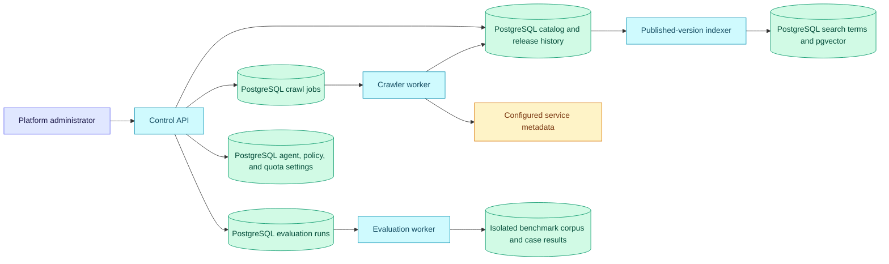

### Data plane

The browser and native MCP clients use the same runtime checks. Redis enforces quotas, and the adapter dispatches scoped operations to the owning service. PostgreSQL records execution state and its timeline.

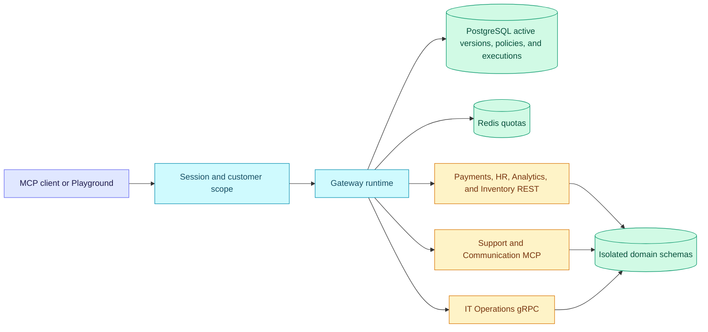

### Agent discovery

MCP clients discover eligible services and tools before requesting an individual schema. The schema lookup checks the current scope and active version again. The gateway exposes four meta-tools: `discover_server`, `discover_tools`, `get_tool_schema`, and `invoke_tool`.

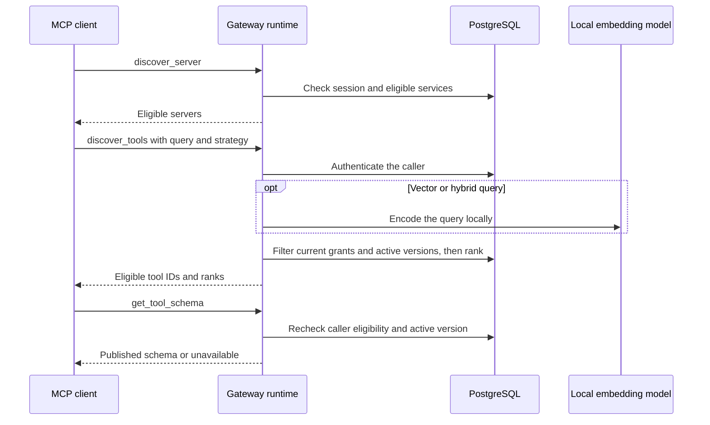

### Tool execution

An authenticated invocation creates an execution record. The gateway validates the active contract, arguments and object scope before dispatch. Approved writes follow the separate approval path described below.

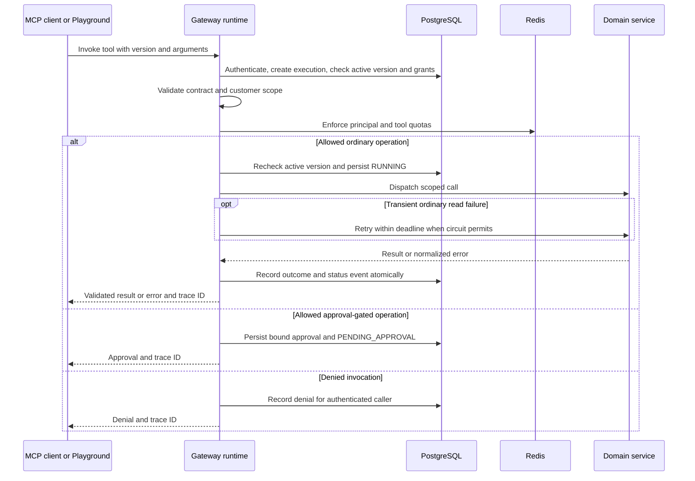

[Architecture guide](docs/architecture.md) · [Architecture decisions](docs/adr/README.md)

## Demo workflow

### Investigate and resolve a duplicate payment

The guided scenario uses synthetic order `O-102`, real service calls and persistent sandbox records. It demonstrates separate Support, Finance and approver identities rather than letting one agent impersonate another.

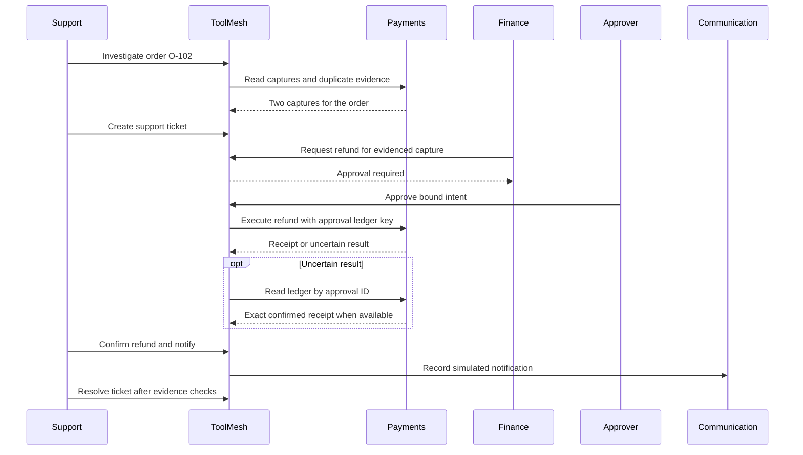

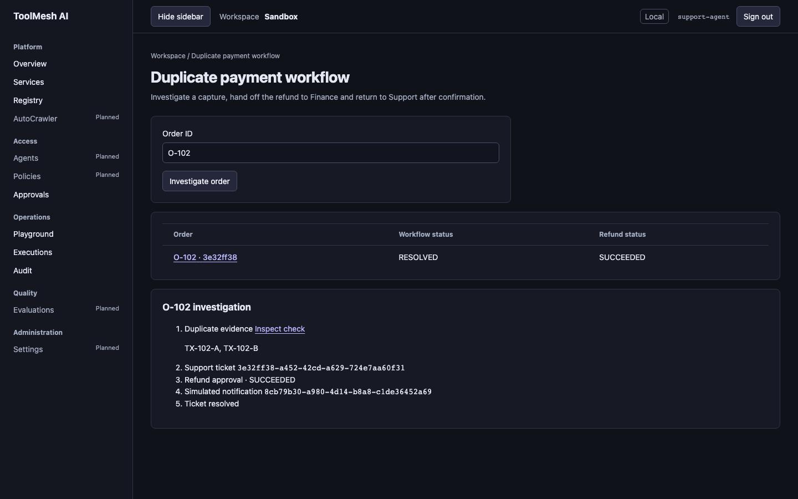

[Run the full workflow](docs/runbook.md#run-the-duplicate-payment-workflow) · [Try another agent profile](docs/runbook.md#run-scripted-agent-scenarios)

### Failure recovery

A downstream refund can commit while the response times out. The execution stays `UNKNOWN` until the reconciler finds and validates the matching receipt. The approval UUID identifies the ledger entry. The delayed-refund test observed one logical refund under concurrent approval. Ordinary uncertain writes stay available for operator review.

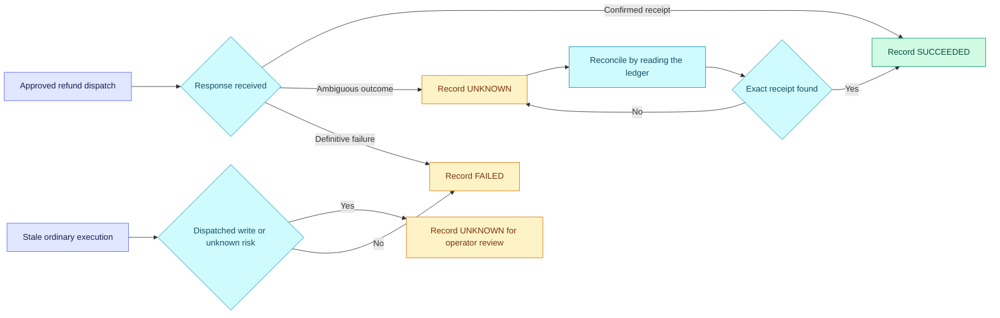

[Receipt reconciliation ADR](docs/adr/0003-refund-approval-and-reconciliation.md) · [Fault rehearsal and raw samples](docs/operations-rehearsal.md)

## Tool discovery and ranking

The gateway filters the catalog using current authorization and active versions before ranking. It combines PostgreSQL full-text search with local Model2Vec embeddings and exact cosine similarity through pgvector. Hybrid results use reciprocal rank fusion (RRF), with a rank constant of 60 and up to 100 candidates per strategy.

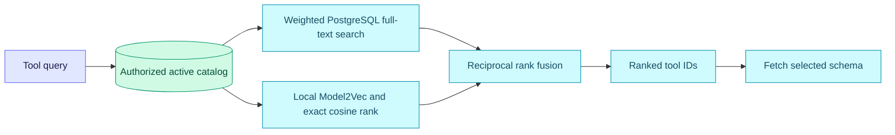

The local embedding model is provisioned separately. The benchmark corpus never becomes an executable catalog. [Evaluation methodology](docs/discovery-evaluation.md)

## Security and governance

| Boundary | Enforcement |
|---|---|
| Identity | Expiring, hashed opaque session tokens; separate sandbox identities |
| Authorization | Role ceilings, current grants, explicit denies, customer and employee scope |
| Tool execution | Active contract, version and argument validation; quota checks |
| Protected writes | Separate approver, bound canonical intent, expiry and single consumption |
| Data access | Scoped domain queries, independent database roles and response redaction |
| Audit | Persistent request IDs, trace IDs, decision and execution events; metadata rather than raw payloads |

### Authorization and approval

A profile bounds the visible services, matching deny rules remove access, and object checks enforce customer and employee scope. Approval-gated writes bind the requester, canonical arguments and tool version. Approval consumption, audit evidence and the execution transition to `RUNNING` commit together.

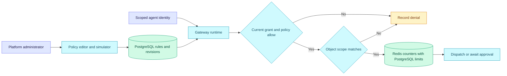

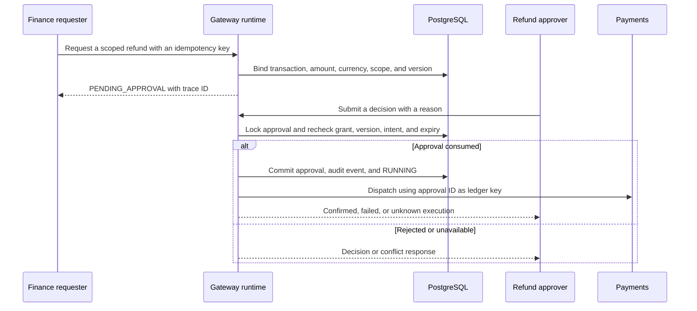

[Threat model](docs/threat-model.md) · [Contract version lifecycle](docs/architecture.md#tool-registration-and-version-lifecycle) · [Database relationships](docs/architecture.md#database-relationships)

## Service catalog

The local Compose topology contains seven backend domain containers. The six primary business domains implement the 36 specified operations; Inventory additionally provides a configured discovery target. Actual visibility depends on published versions and caller permissions.

| Service | Protocol | Responsibility |
|---|---|---|
| Payments | REST | Transactions, duplicate captures and refund ledger |
| Customer Support | MCP | Customer support and ticket lifecycle |
| Communication | MCP | Simulated notifications and messages |
| IT Operations | gRPC | Health, incident and simulated restart operations |
| Human Resources | REST | Scoped employee and HR operations |
| Analytics | REST | Business reporting and metrics |
| Inventory | REST | Inventory service and crawler integration |

## Operations console

### Tool registry


Browse the published catalog, inspect tool schemas and manage contract versions. The authorization and execution boundaries remain on the server.

### Agent Playground

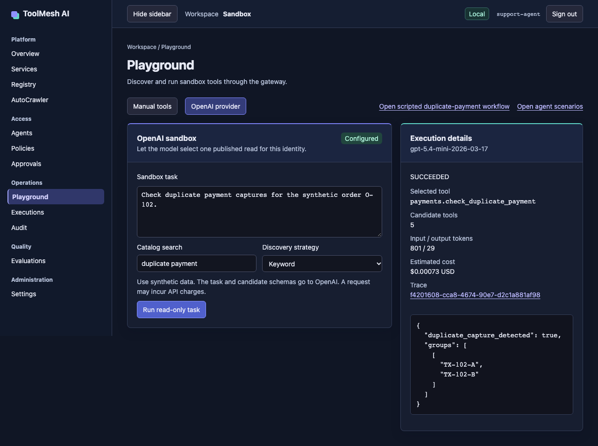

Inspect selected tool, result, trace and provider-reported usage for an optional OpenAI read. The console also supports manual invocations and scripted agent scenarios.

### Evaluation workspace

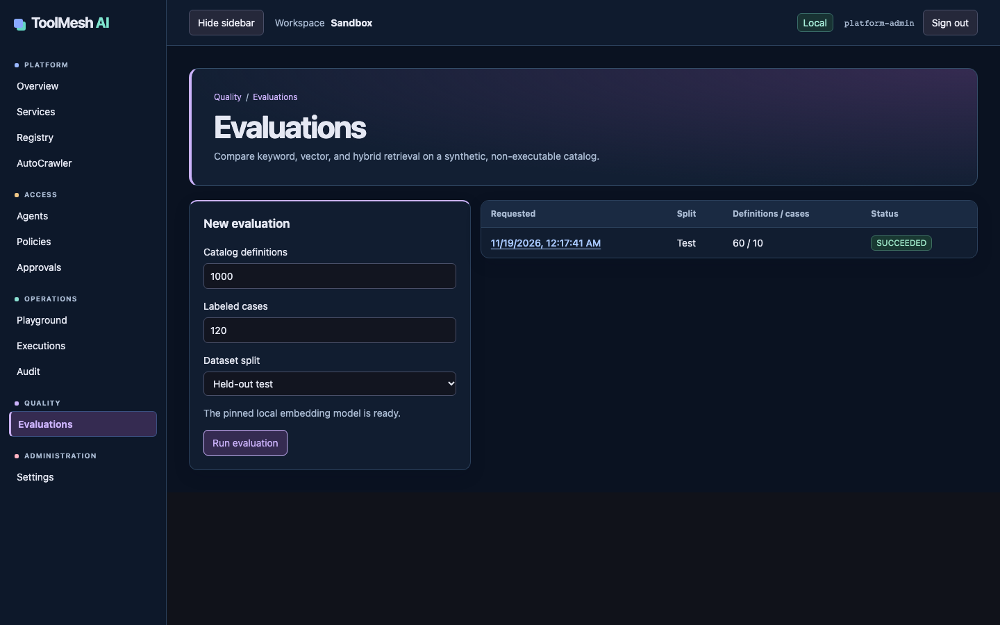

Compare retrieval strategies using reproducible, isolated evaluation runs and export the case-level results.

[Approval interface](docs/screenshots/m2-approval.png) · [Crawler](docs/screenshots/m3-crawler.png) · [Execution timeline](docs/screenshots/m6-executions.png) · [Mobile console](docs/screenshots/m8-overview-mobile.png)

## OpenAI Playground

The optional provider performs one scoped read per task. It receives the synthetic prompt and up to eight authorized read schemas. The gateway injects customer scope, validates the chosen tool and version, and applies its normal execution checks.

Set `OPENAI_API_KEY` locally and add the following reference in the ignored root `.env`.

```dotenv
TOOLMESH_OPENAI_API_KEY=${OPENAI_API_KEY}
```

```sh
docker compose up --build -d api web
```

Open **Playground → OpenAI provider**. The provider is optional; use synthetic prompts only. [Provider boundaries](docs/architecture.md#openai-playground)

## Benchmarks

These sandbox measurements include a held-out retrieval experiment, four fixed provider tasks, and a local load and fault rehearsal. The source tables and raw exports are linked below each result.

### Retrieval quality — 10,000 synthetic definitions, 1,000 labeled cases

| Strategy | Recall@5 |
|---|---:|
| Keyword | 71.2% |
| Vector | 81.7% |
| Hybrid | **89.5%** |

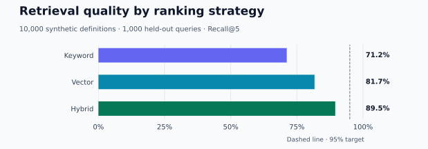

Hybrid SQL p95 was **231.01 ms**. It did not reach the 95% recall target; every strategy returned candidates on negative cases. [Method](docs/discovery-evaluation.md) · [Raw results](benchmarks/results/m4-seed42-10000x1000.json.gz)

### Model selection — corrected M8 provider comparison

Four fixed synthetic tasks per strategy using GPT-5.4 mini; 16 verified reads across all strategies.

| Strategy | Verified reads | Input tokens (sum) | Output tokens (sum) |
|---|---:|---:|---:|
| Upfront schemas | 4/4 | 10,705 | 64 |
| Keyword | 4/4 | 710 | 64 |
| Vector | 4/4 | 756 | 64 |
| Hybrid | 4/4 | 760 | 70 |

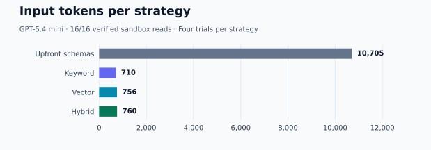

Hybrid used **92.9% fewer reported input tokens** than upfront schemas in this small comparison. This comparison covers four fixed read tasks and measures input to the model selection step. [Corrected report](docs/release-validation.md#m8-corrected-provider-validation) · [Raw results](benchmarks/results/m8-openai-corrected.json)

[Regenerate the charts](docs/charts/README.md)

### Reliability and load

| Experiment | Documented outcome |
|---|---|
| 100-client warm discovery burst | 100 HTTP 200 responses; 567.08 ms client p95 |
| Payment outage rehearsal | 20 healthy reads at concurrency four; circuit breaker opened after fault retries |
| Redis fault | Fail-closed quota behavior verified |
| Delayed refund response | One logical refund; uncertain outcome reconciled against exact receipt |

[Release validation](docs/release-validation.md) · [Operations rehearsal](docs/operations-rehearsal.md) · [Raw load results](benchmarks/results/m7-local-release.json)

## Quick start

Install Docker and Compose v2. Run these commands from the repository root.

```sh
cp -n .env.example .env
docker compose config --quiet
docker compose up --build -d --wait
curl -fsS http://127.0.0.1:8000/readyz
```

| Interface | Address |
|---|---|
| Console | http://127.0.0.1:5173 |
| REST API documentation | http://127.0.0.1:8000/docs |
| MCP Streamable HTTP | http://127.0.0.1:8000/mcp/ |

Sign in as `platform-admin` using `TOOLMESH_ADMIN_PASSWORD` from your local `.env`. Follow the [single-tool walkthrough](docs/runbook.md#invoke-a-single-tool) or the [duplicate-payment demo](docs/runbook.md#run-the-duplicate-payment-workflow). `docker compose down` preserves PostgreSQL data. On upgrades, merge new `.env.example` keys without changing existing database passwords independently of database roles.

### Enable local embeddings

```sh
uv sync --locked --python 3.12
HF_HUB_DISABLE_XET=1 uv run --locked python -m gateway.embeddings --output .models/discovery
docker compose restart api
```

Base keyword retrieval does not require the model. Semantic retrieval and evaluation require the pinned, checksum-verified local model. [Detailed setup and troubleshooting](docs/runbook.md)

## Repository and roadmap

```text
ToolMesh-AI/
├── gateway/           # MCP runtime, discovery, policies, approvals, recovery
├── control_plane/     # Registry, crawler, governance, schemas
├── services/          # Independent domain implementations
├── shared/            # Typed contracts, database helpers, Protobuf
├── db/migrations/     # Alembic schema evolution and fixtures
├── apps/web/          # React console and Playwright tests
├── benchmarks/        # Evaluation harness and committed evidence
├── tests/             # Python unit and integration checks
├── infra/             # Container and PostgreSQL initialization
├── docs/              # Architecture, ADRs, screenshots, runbooks
├── .github/workflows/ # CI validation
└── compose.yaml       # Local deployment topology
```

| Milestone | Capability | Status |
|---|---|---|
| M0–M1 | Foundation, native MCP gateway and initial services | Implemented |
| M2 | Refund approval and guided cross-service workflow | Implemented |
| M3 | Registry, crawler and gRPC integration | Implemented |
| M4 | Ranked discovery and evaluation | Implemented |
| M5 | Domain tools, governance and scripted profiles | Implemented |
| M6 | Reliability, traces and operations | Implemented |
| M7 | Local sandbox release and benchmarks | Implemented |
| M8 | Optional read-only OpenAI Playground and console refresh | Implemented |
| M9.1.1 | Slice A contracts and additive PostgreSQL schema for protected execution | Schema implemented. Durable dispatch remains disabled. |
| M9.1.2 | Protected command store, scoped idempotency, and authenticated payload envelopes | Store verified in isolated tests. Gateway integration awaits a later milestone. |
| M9.1.3 | Atomic protected decisions and authorization revision coordination | Internal approval service. Durable dispatch remains disabled. |
| M9.1.4 Steps 1–3 | PostgreSQL ownership, synthetic send markers, and fenced finalization | Isolated sandbox implementation. Synthetic adapters remain test-only. |
| M9.1.4 Step 4 | Standalone PostgreSQL ownership worker | Isolated sandbox only. Claims, lease renewal, fenced release, and pre-send recovery. |
| M9.1.4 Step 5 | Synthetic adapter integration | Refund and IT restart implemented for isolated sandbox review. |
| M9.1.4 Step 6 | Fenced reconciliation for synthetic refunds and IT restarts | The disposable worker verifies due refunds and restarts with retry limits and operator attention. Slice 4 acceptance pending. |
| Future | Autonomous multi-step model workflows, production identity, tenant isolation, high availability | Planned |

[Changelog](CHANGELOG.md) · [Sandbox release v0.1.0](https://github.com/NagaRamya1531-tech/ToolMesh-AI/tree/v0.1.0)

## Development and testing

Use Python 3.12, uv, Node.js 22, npm, and Docker Compose. Provision the pinned model for semantic retrieval tests. Integration and browser runs modify sandbox fixtures, so use a separate disposable Compose project with a fresh database volume for each suite. Stop any stack occupying the default ports first. Use a new project name for subsequent fresh runs.

```sh
uv sync --locked --python 3.12
uv run --locked ruff check .
uv run --locked ruff format --check .
uv run --locked mypy gateway control_plane shared services benchmarks
HF_HUB_DISABLE_XET=1 uv run --locked python -m gateway.embeddings --output .models/discovery

npm --prefix apps/web ci
npm --prefix apps/web run build
(cd apps/web && npx playwright install chromium)

docker compose -p toolmesh-doccheck up --build -d --wait
docker compose -p toolmesh-doccheck run --rm migrate
TOOLMESH_EXPECT_DRAFT=1 npm --prefix apps/web run test:e2e -- overview.spec.ts workspace.spec.ts provider.spec.ts sidebar.spec.ts
npm --prefix apps/web run test:e2e -- refund.spec.ts crawler.spec.ts
npm --prefix apps/web run test:e2e -- evaluations.spec.ts
npm --prefix apps/web run test:e2e -- access.spec.ts
docker compose -p toolmesh-doccheck down
docker compose -p toolmesh-pycheck up --build -d --wait
TOOLMESH_TEST_API=http://127.0.0.1:8000 TOOLMESH_TEST_REQUIRE_MODEL=1 TOOLMESH_TEST_MUTATE_POLICY=1 TOOLMESH_TEST_COMPOSE_PROJECT=toolmesh-pycheck uv run --locked pytest -q
docker compose -p toolmesh-pycheck down
```

For standalone Python checks, run `uv run --locked pytest -q` without setting `TOOLMESH_TEST_API`. Set `TOOLMESH_TEST_WEB` and `TOOLMESH_TEST_API` when choosing alternate host ports. The [CI workflow](.github/workflows/ci.yml) records the expected verification steps, including the secret scan. [Milestone documentation checklist](docs/contributing.md#milestone-definition-of-done)

## Engineering tradeoffs

| Decision | Rationale and constraint |
|---|---|
| One gateway process, separate domain containers | Shared transactions simplify publication, approvals, and execution state. Each domain keeps its own schema and login. |
| Exact cosine ranking on eligible rows | Filtering happens before scoring. Cost rises with the size of the authorized set. |
| Ledger-based reconciliation | Receipt checks let the gateway resolve uncertain approved writes without dispatching the write again. |
| Scripted workflows and optional provider reads | Repeatable supported workflows and a bounded provider path share the same runtime policy. |

[Architecture decision records](docs/adr/README.md)

## Limitations

- The supported deployment is a single local gateway process and Compose sandbox. Production identity federation, tenant isolation, and high availability remain planned.
- Backend domain data is synthetic; refunds, notifications and restarts do not affect actual enterprise systems.
- The crawler operates on configured targets and supported adapters.
- Circuit state is process-local. Uncertain ordinary writes require operator review.
- OpenAI Playground executes a single read. The other agent workflows use scripted LangGraph profiles.
- Retrieval quality falls short of the stated target at 10,000 definitions; negative-case abstention and sustained capacity need further evaluation.

## Engineering documentation

| Document | Content |
|---|---|
| [Architecture](docs/architecture.md) | Control and data planes, sequences, ER diagrams, storage and deployment |
| [ADRs](docs/adr/README.md) | Design decisions and tradeoffs |
| [Threat model](docs/threat-model.md) | Security assumptions and boundaries |
| [Runbook](docs/runbook.md) | Installation, demos and incident procedures |
| [Discovery evaluation](docs/discovery-evaluation.md) | Data generation and retrieval experiments |
| [Release validation](docs/release-validation.md) | Provider, load and end-to-end verification evidence |
| [Operations rehearsal](docs/operations-rehearsal.md) | Fault injection and recovery results |
| [Software requirements](docs/ToolMesh_AI_SRS.md) | Proposed scope and requirements |

ToolMesh is an independent implementation inspired by Uber’s public MCP gateway architecture and the Model Context Protocol. [Model Context Protocol](https://modelcontextprotocol.io/)
