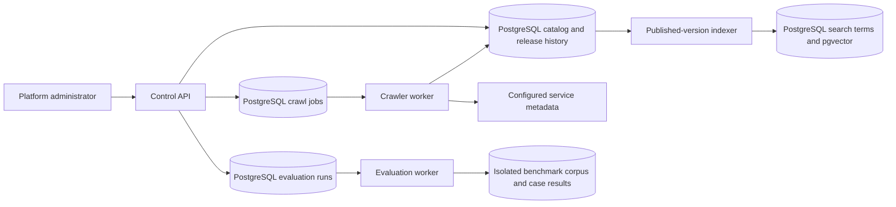
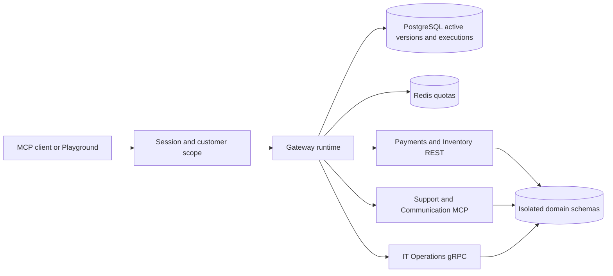
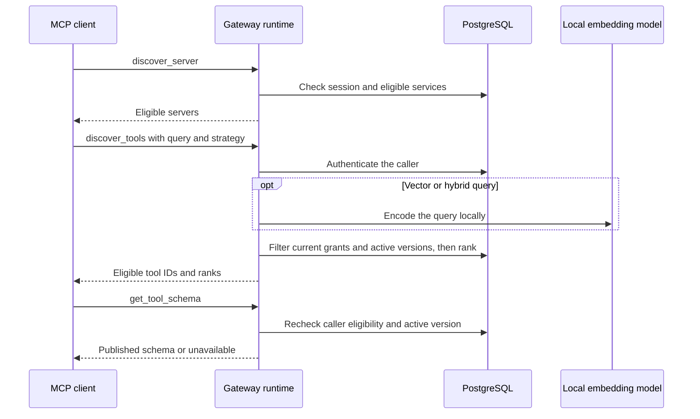
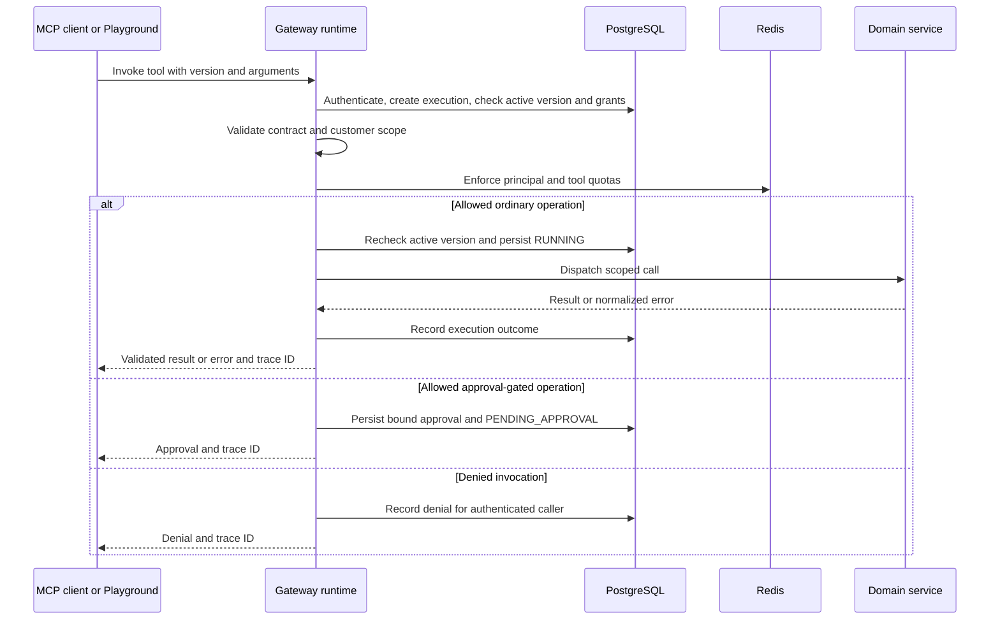
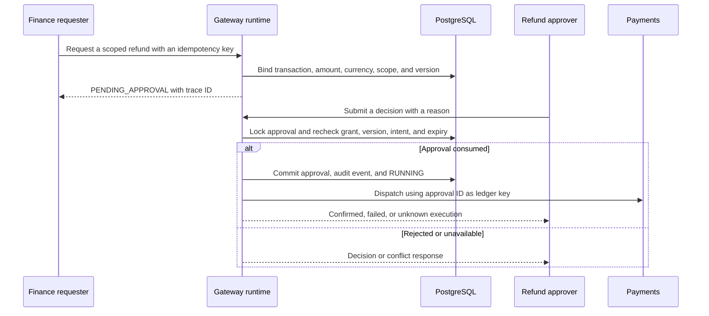
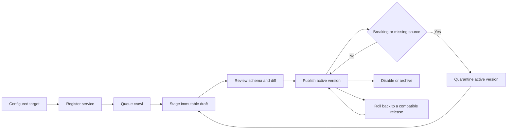
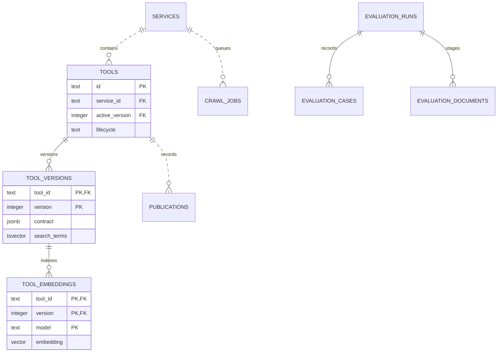
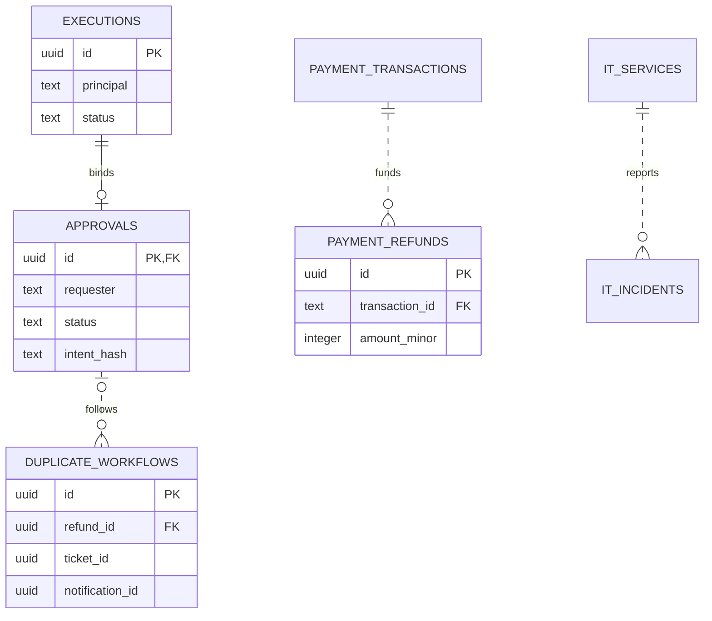
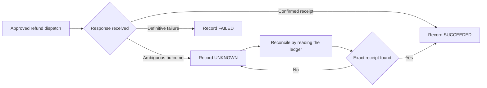
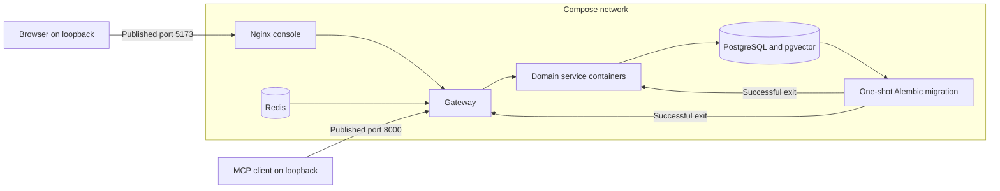

# Architecture

Compose starts a local Postgres instance with pgvector, Redis, the Alembic migration job, FastAPI and an Nginx-hosted React console. The browser sends readiness queries to the same origin. Nginx forwards them to FastAPI over the Compose network. Vite provides the equivalent proxy during frontend development.

The gateway exposes a FastAPI control API and a FastMCP Streamable HTTP endpoint. The control plane owns publication and catalog metadata. Invocation through either entry point uses the same gateway runtime. The registry contains immutable JSON Schema snapshots and an active-version pointer. A transaction locks the tool row, records the approval reason and actor, and sets the active version.

Payments runs as a REST service and Support runs as a native MCP server. Each accesses its own PostgreSQL schema through a distinct login. The gateway dispatches to fixed Compose destinations with separate internal credentials. It validates the persisted contract against the running adapter, verifies the authenticated caller's customer scope and sends the authorized customer ID downstream. Both services query by that customer ID.

Local principals have explicit service and write grants defined in code. The database stores only hashed opaque session tokens and their expiry. Runtime does not cache allow decisions. Redis enforces fixed windows for login and invocation. Before dispatch, PostgreSQL stores a trace ID, caller, tool version and running status. Successful outcomes require contract-validated downstream data. Failed writes whose effect is uncertain return `UNKNOWN`. Traces persist metadata, rather than caller payloads or free-form service results.

## Control plane

The administrator and crawler own catalog changes. The indexer derives searchable metadata from published versions. Evaluation jobs use a separate corpus.

## Data plane

The browser and native MCP client share the same runtime policies. Each domain service uses an isolated PostgreSQL role.

### Agent discovery

### Tool execution

## Health contract

| Endpoint | Behavior |
|---|---|
| `GET /healthz` | HTTP 200 and process liveness. Works during dependency failure. |
| `GET /readyz` | HTTP 200 when Postgres, pgvector, the expected migration revision, the sandbox workspace and Redis are usable. HTTP 503 with the same response schema when a check fails. |

Probes run concurrently under individual deadlines. Responses include a server-generated request ID, bypass caching and return bounded status values with UTC check time. The expected revision in the readiness query must be updated when a migration advances the schema. The console refreshes every 30 seconds and supports a manual retry. When a request fails after a valid response, the console labels the retained result as the last successful check.

[ADR 0001](adr/0001-local-service-boundaries.md) · [Threat model](threat-model.md)

[ADR 0002](adr/0002-published-contracts-and-domain-isolation.md)

## Guided workflow and refund approval

A durable workflow record links the duplicate-check trace, structured Support ticket evidence, refund approval and simulated notification. Support starts and closes the investigation. Finance selects an evidenced capture and requests the refund through the runtime. A separate approver reviews the canonical intent. The scripted workflow carries IDs across handoffs and never takes another principal's identity.

The control plane serializes each approval decision with a PostgreSQL row lock. Approval consumption, the audit event and the execution transition to running commit together. The gateway rechecks the requester grant, customer scope, published version, matching contract and canonical intent before consumption. Payments uses the approval UUID as its ledger key and locks the capture before checking currency and total refunded balance. Reconciliation reads the ledger by that UUID, validates the complete receipt and updates the execution only after confirmation.

Communication runs as a third isolated MCP service. Its local message outbox enforces one simulated notification per customer and refund. Support changes the ticket status only after the gateway confirms that the refund belongs to the ticket's order and the outbox contains the corresponding notification.

[ADR 0003](adr/0003-refund-approval-and-reconciliation.md)

## Discovery and release lifecycle

The service registry maps stable IDs to operator-configured Compose targets. Administrators register targets and can edit their display names. The read-only probes fetch authenticated OpenAPI descriptions and native MCP tool lists. For IT, the crawler reads the generated Protobuf descriptor after confirming the configured endpoint over gRPC. It skips operations outside the adapter map and exposes unsupported entries in the crawl result.

A PostgreSQL job queue claims work with row locks and a finite lease. Each successful job commits its output and draft changes together. Immutable schema versions contain their source metadata. Added, removed, changed and required fields are shown in the review UI. A breaking or missing source revokes the active pointer and records quarantine in release history. Restoring discovery requires manual approval of a compatible replacement. Curated adapters keep their static serializers and block incompatible wire contracts until the adapter has been reviewed.

[ADR 0004](adr/0004-allowlisted-crawler-and-grpc.md)

## Ranked discovery

Runtime tool search materializes the authorization-filtered active catalog before scoring. PostgreSQL builds weighted English full-text terms from each version's safe name and description. It also stores a 256-dimensional pgvector row for every active version indexed with the pinned Model2Vec model. Query embeddings are produced locally. Keyword and exact cosine rankings use stable tie breaks. Hybrid search applies reciprocal rank fusion with a rank constant of 60 and up to 100 candidates from each strategy.

Evaluation jobs use a separate document table keyed by run. Their label fixtures simulate scope restrictions and never enter the executable catalog. Progress and case results survive process restarts. The worker regenerates an interrupted run from its seed and clears transient copies of benchmark documents after completion. Exports retain the configuration, fingerprint, case labels, ranked IDs, and raw measurements.

[ADR 0005](adr/0005-authorization-prefiltered-discovery.md)

## Refund approval

The requester and approver are separate sandbox identities. Approver actions and protected outcomes are recorded for audit. [Threat model](threat-model.md) · [Refund ADR](adr/0003-refund-approval-and-reconciliation.md)

## Tool registration and version lifecycle

Publication is an explicit administrator decision. A disabled tool can be republished; an archived tool cannot. Compatible rollback is limited to earlier published versions that satisfy current source rules.

## Database relationships

These ER diagrams show selected entities from the Alembic migrations. A dashed line represents a non-identifying foreign-key relationship in Mermaid notation. Cross-service correlations between the execution ID, ledger ID, ticket ID, and notification ID are maintained by the application and omitted from these foreign-key views.

### Registry and retrieval

The active pointer is a nullable composite reference from the tool ID and active version into `tool_versions`. Benchmark documents are transient. Run and case records remain available for export.

### Execution and domain state

## Failure recovery

The reconciler does not replay writes. Expired or rejected approvals and revoked grants block dispatch. Quota unavailability blocks writes. Interrupted crawl jobs can be reclaimed after their lease expires. Interrupted evaluation runs rebuild deterministic inputs from their stored configuration. [Operational procedures](runbook.md#diagnose-startup-and-dependency-failures)

## Local deployment

The gateway joins the Compose network and publishes its HTTP port on loopback. PostgreSQL, Redis, and domain services have no host port bindings. The optional embedding files mount read-only. The [runbook](runbook.md) covers bootstrap and faults.

## Technology choices

| Technology | Engineering rationale |
|---|---|
| FastAPI and FastMCP | Typed HTTP contracts and native MCP Streamable HTTP share one invocation path. |
| PostgreSQL and Alembic | Transactions coordinate catalog, decision, and execution state. Migrations declare domain roles and schema evolution. |
| PostgreSQL text search and pgvector | Weighted lexical rank and exact cosine ranking use the same scoped relational dataset. |
| Redis | Shared quota counters keep rate-limit state separate from the transactional ledger. |
| Protobuf and gRPC | Checked-in descriptors define the IT contract and support reproducible stub generation. |
| React, TypeScript, Vite, and Nginx | A typed console builds to static assets. Nginx serves it and forwards same-origin API requests. |
| Model2Vec | The pinned CPU model provides local semantic retrieval without an inference service dependency. |

See the [ADR index](adr/README.md) for the tradeoffs and accepted boundaries.
