# Architecture

Compose starts a local Postgres instance with pgvector, Redis, the Alembic migration job, FastAPI and an Nginx-hosted React console. The browser sends readiness queries to the same origin. Nginx forwards them to FastAPI over the Compose network. Vite provides the equivalent proxy during frontend development.

The gateway exposes a FastAPI control API and a FastMCP Streamable HTTP endpoint. The control plane owns publication and catalog metadata. Invocation through either entry point uses the same gateway runtime. The registry contains immutable JSON Schema snapshots and an active-version pointer. A transaction locks the tool row, records the approval reason and actor, and sets the active version.

Payments runs as a REST service and Support runs as a native MCP server. Each accesses its own PostgreSQL schema through a distinct login. The gateway dispatches to fixed Compose destinations with separate internal credentials. It validates the persisted contract against the running adapter, verifies the authenticated caller's customer scope and sends the authorized customer ID downstream. Both services query by that customer ID.

Profiles define service ceilings, while PostgreSQL stores managed agents, enabled state, and versioned tool policies. Explicit deny takes precedence. The gateway checks customer scope and the assigned HR employee before dispatch. The database stores only hashed opaque session tokens and their expiry. Runtime does not cache allow decisions. Redis enforces fixed windows for login and invocation. Before dispatch, PostgreSQL stores a trace ID, caller, tool version and running status. Successful outcomes require contract-validated downstream data. Failed writes whose effect is uncertain return `UNKNOWN`. Traces persist metadata, rather than caller payloads or free-form service results.

## Control plane

The administrator and crawler own catalog changes. The indexer derives searchable metadata from published versions. Evaluation jobs use a separate corpus.

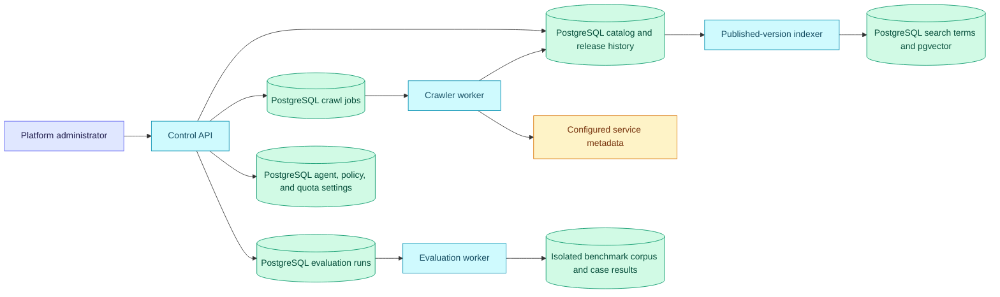

## Data plane

The browser and native MCP client share the same runtime policies. Each domain service uses an isolated PostgreSQL role.

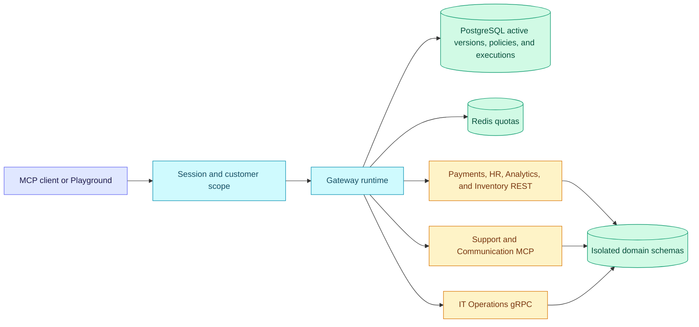

### Agent discovery

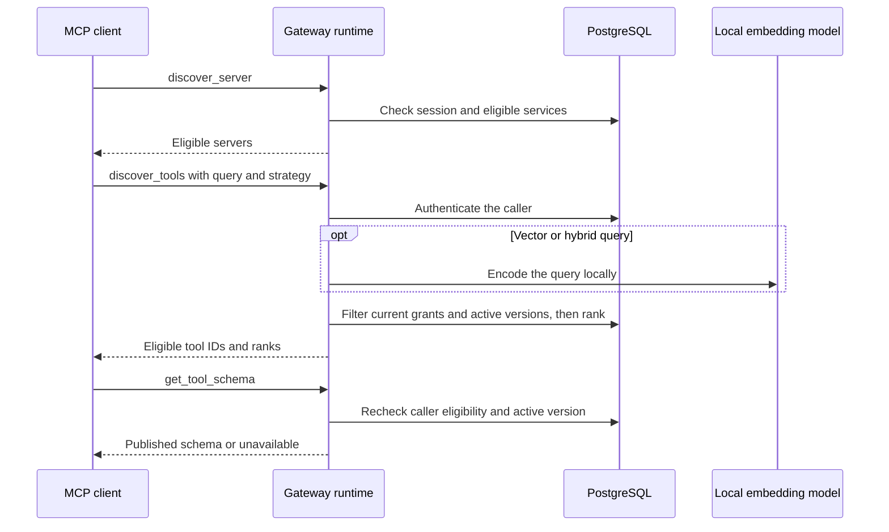

### Tool execution

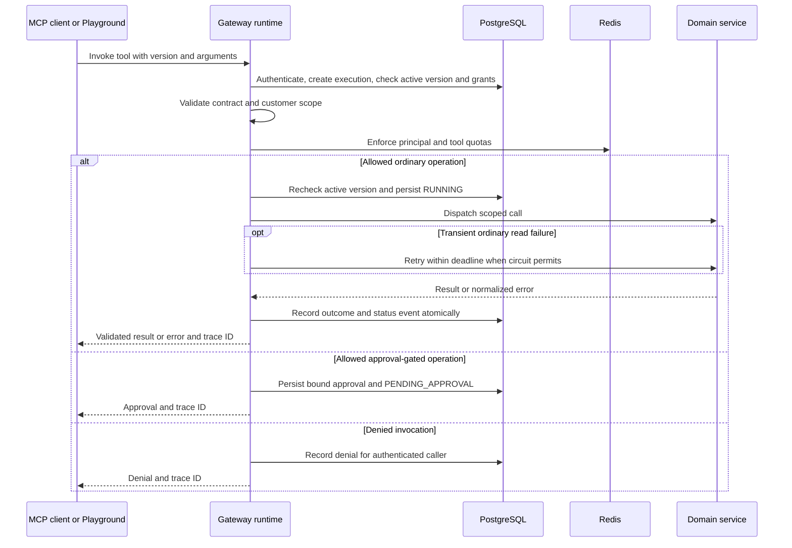

## Health contract

| Endpoint | Behavior |
|---|---|
| `GET /healthz` | HTTP 200 and process liveness. Works during dependency failure. |
| `GET /readyz` | HTTP 200 when Postgres, pgvector, the expected migration revision, the sandbox workspace and Redis are usable. HTTP 503 with the same response schema when a check fails. |

Probes run concurrently under individual deadlines. Responses include a server-generated request ID, bypass caching and return bounded status values with UTC check time. The expected revision in the readiness query must be updated when a migration advances the schema. The console refreshes every 30 seconds and supports a manual retry. When a request fails after a valid response, the console labels the retained result as the last successful check.

[ADR 0001](adr/0001-local-service-boundaries.md) · [Threat model](threat-model.md)

[ADR 0002](adr/0002-published-contracts-and-domain-isolation.md)

## Guided workflow and refund approval

A durable workflow record links the duplicate-check trace, structured Support ticket evidence, refund approval and simulated notification. Support starts and closes the investigation. Finance selects an evidenced capture and requests the refund through the runtime. A separate approver reviews the canonical intent. The scripted workflow carries IDs across handoffs and never takes another principal's identity.

The control plane serializes each approval decision with a PostgreSQL row lock. Approval consumption, the audit event and the execution transition to running commit together. The gateway rechecks the requester grant, customer scope, published version, matching contract and canonical intent before consumption. Payments uses the approval UUID as its ledger key and locks the capture before checking currency and total refunded balance. Reconciliation reads the ledger by that UUID, validates the complete receipt and updates the execution only after confirmation.

Communication runs as a third isolated MCP service. Its local message outbox enforces one simulated notification per customer and refund. Support changes the ticket status only after the gateway confirms that the refund belongs to the ticket's order and the outbox contains the corresponding notification.

[ADR 0003](adr/0003-refund-approval-and-reconciliation.md)

## Discovery and release lifecycle

The service registry maps stable IDs to operator-configured Compose targets. Administrators register targets and can edit their display names. The read-only probes fetch authenticated OpenAPI descriptions and native MCP tool lists. For IT, the crawler reads the generated Protobuf descriptor after confirming the configured endpoint over gRPC. It skips operations outside the adapter map and exposes unsupported entries in the crawl result.

A PostgreSQL job queue claims work with row locks and a finite lease. Each successful job commits its output and draft changes together. Immutable schema versions contain their source metadata. Added, removed, changed and required fields are shown in the review UI. A breaking or missing source revokes the active pointer and records quarantine in release history. Restoring discovery requires manual approval of a compatible replacement. Curated adapters keep their static serializers and block incompatible wire contracts until the adapter has been reviewed.

[ADR 0004](adr/0004-allowlisted-crawler-and-grpc.md)

## Ranked discovery

Runtime tool search materializes the authorization-filtered active catalog before scoring. PostgreSQL builds weighted English full-text terms from each version's safe name and description. It also stores a 256-dimensional pgvector row for every active version indexed with the pinned Model2Vec model. Query embeddings are produced locally. Keyword and exact cosine rankings use stable tie breaks. Hybrid search applies reciprocal rank fusion with a rank constant of 60 and up to 100 candidates from each strategy.

Evaluation jobs use a separate document table keyed by run. Their label fixtures simulate scope restrictions and never enter the executable catalog. Progress and case results survive process restarts. The worker regenerates an interrupted run from its seed and clears transient copies of benchmark documents after completion. Exports retain the configuration, fingerprint, case labels, ranked IDs, and raw measurements.

[ADR 0005](adr/0005-authorization-prefiltered-discovery.md)

## Refund approval

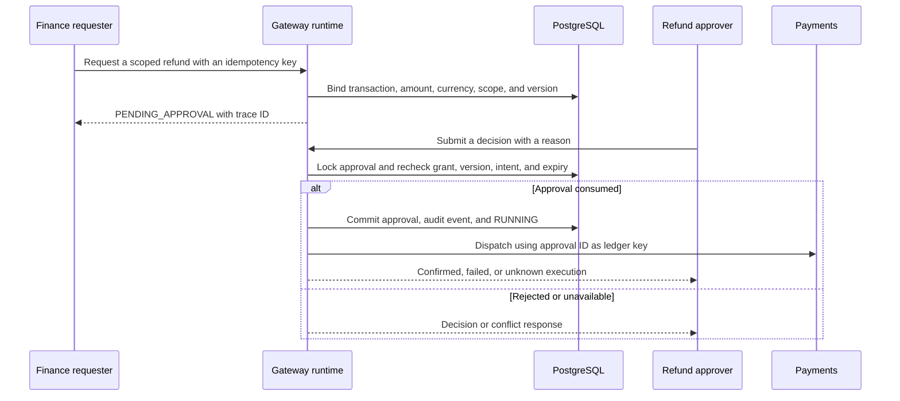

The requester and approver are separate sandbox identities. Approver actions and protected outcomes are recorded for audit. [Threat model](threat-model.md) · [Refund ADR](adr/0003-refund-approval-and-reconciliation.md)

## Tool registration and version lifecycle

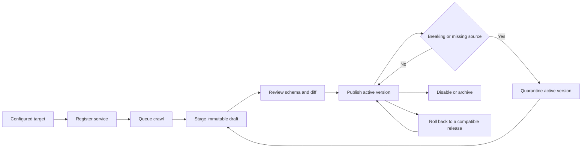

Publication is an explicit administrator decision. A disabled tool can be republished; an archived tool cannot. Compatible rollback is limited to earlier published versions that satisfy current source rules.

## Database relationships

These ER diagrams show selected entities from the Alembic migrations. A dashed line represents a non-identifying foreign-key relationship in Mermaid notation. Cross-service correlations between the execution ID, ledger ID, ticket ID, and notification ID are maintained by the application and omitted from these foreign-key views.

### Registry and retrieval

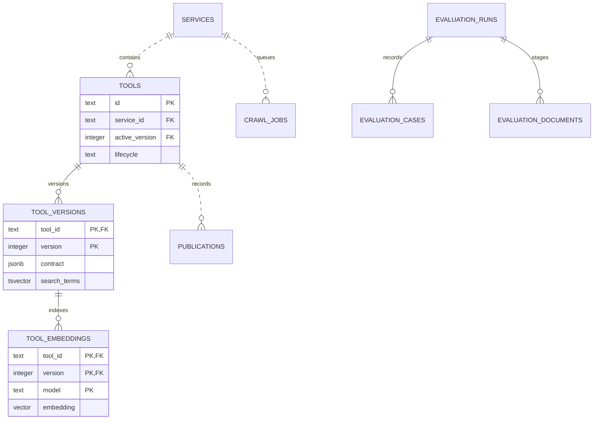

The active pointer is a nullable composite reference from the tool ID and active version into `tool_versions`. Benchmark documents are transient. Run and case records remain available for export.

### Execution and domain state

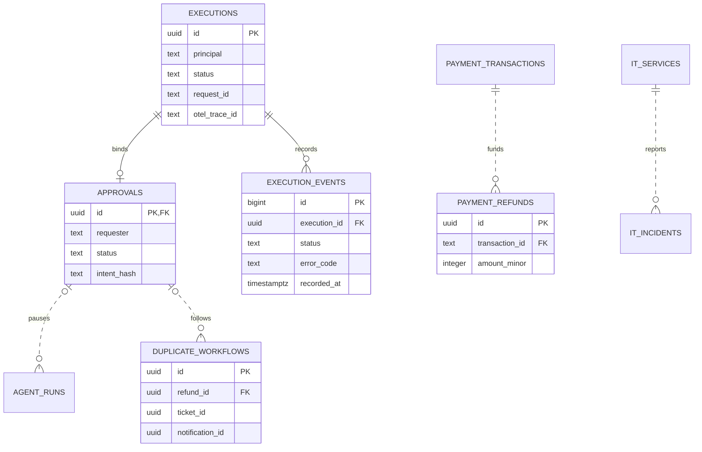

## Protected command storage

M9.1.2 adds an isolated store for simulated refunds and IT restarts. It takes shared locks on the dispatch gate, authorization revision, and catalog, in that order. Missing coordination rows or a gate other than `DURABLE` reject durable admission. The store serializes matching request keys with a transaction-scoped advisory lock. The execution, pending approval, reservation, sealed command, and audit event commit together. Pre-commit lock, deadlock, and serialization errors permit bounded database-only retries. An ambiguous commit triggers a fresh transaction to look up the same reservation without writing a second command.

The store resolves a matching key before choosing the active tool version. V1 canonicalizes the pinned contract's closed object schema and normalizes object ordering. Separate HMAC-SHA256 keys protect scoped request lookup and effect-intent binding. Response field selection does not change the operation identity. Imported legacy aliases can resolve existing reservations. A matching legacy reservation without an imported alias blocks a new command. Existing legacy data is left in place.

Payloads use AES-256-GCM with independently generated data keys and nonces. Associated data binds the record type, execution ID, scope, and schema version. An injected sandbox provider wraps the data key with a versioned key held outside PostgreSQL. It supports rewrapping ciphertext under a new wrapping key. Raw client keys and argument plaintext are absent from SQL parameters and from the store's legacy and audit rows. The legacy approval row carries empty arguments and keyed placeholders.

The running gateway does not use this store. Existing application privileges and dispatch behavior are unchanged. Integration requires an authenticated caller, scoped runtime grants, shared digest key custody across replicas, guarded policy writers, and legacy cutover. Digest-key rotation, downstream deduplication, and automatic replay remain outside this slice. [Store](../gateway/execution_store.py) · [Payload protection](../gateway/execution_crypto.py) · [PostgreSQL tests](../tests/test_execution_store.py)

## Atomic protected approval

M9.1.3 adds an internal decision service for the two protected tools. It locks the dispatch gate, authorization revision, catalog, key reservation, execution, approval, and command in that order. It requires a separate human with a current customer/tool entitlement, authenticates the sealed intent, and checks the pinned catalog contract and keyed intent digest. Approval also requires the requester's current scope and active version. Rejection can close a valid pending intent after requester authorization is revoked.

An approval moves the command to READY and projects RUNNING for execution status. Approval, execution, command, revision evidence, encrypted reason, and audit data commit together. Rejection and expiration have terminal projections. The database clock determines expiry after lock waits and a caller-configured positive window determines the latest allowable send. A same-actor retry with the same decision and authenticated reason returns the original decision after entitlement revocation, while new decisions still require an active entitlement. Missing coordination or crypto keys prevent a human decision. System expiry can safely close an overdue pending command using metadata alone.

Revision 0011 adds statement-level guards for account, policy, refund grant, entitlement, and catalog mutations. Catalog and crawler callers take the guard before their row locks. Existing legacy paths skip command-backed approvals. The protected service has no public route or dispatcher, and the deployed gate remains disabled. A future worker must recheck current authorization and the deadline before sending. Legacy cutover still requires quiescing old binaries. [Decision service](../gateway/execution_approval.py) · [Migration](../db/migrations/versions/0011_atomic_execution_approval.py)

### Synthetic send markers and finalization

The ownership store exposes explicitly enabled sandbox operations. A marker moves CLAIMED to DISPATCHING and retains the RUNNING public status. A valid finalizer commits attempt outcome, synthetic receipt, command, execution status, and audit evidence together. An unresolved marked attempt becomes UNKNOWN without a receipt or replacement send. The test adapter attests typed outcomes with an ephemeral fixture key and commits its operation ledger separately from the execution transaction.

After an ambiguous commit, the harness reads the primary by execution, worker, and generation. A marker discovered by reread grants no permission to invoke. Matching terminal evidence confirms finalization without another effect. Ownership expires at or before the dispatch deadline in this slice, so an outcome arriving after lease expiry cannot be finalized by that owner. The synthetic methods are disconnected from gateway routes and worker startup. Disposable fixtures install PostgreSQL guards that reserve consumption inserts for the audit-table owner and reject updates, deletes, and truncation of consumption evidence. The fixture owner and roles with equivalent DDL authority are trusted. The synthetic store refuses invocation authorization when those guards are unavailable. [Ownership store](../gateway/execution_worker_store.py) · [PostgreSQL tests](../tests/test_execution_worker_postgres.py)

### Standalone ownership sandbox

`python -m gateway.execution_worker` is an explicit sandbox entry point for pre-send ownership. The dedicated login reads Alembic metadata and executes the fixture's allowlisted ownership operations. A non-login function owner holds the table privileges required by the fixed SQL. The worker has no direct table writes. Startup accepts only revision `0011`. The client sets READ COMMITTED, the restricted functions reject other isolation levels, and ownership mutations recheck the revision after taking coordination locks. Schema provisioning stays outside worker startup.

The isolated Compose definition uses a separate database and worker profile. PostgreSQL serializes claim and renewal by registered identity and permits one live lease per registration. A disposable login may register multiple independent process identities. Graceful shutdown uses a fenced release. An unconfirmed claim or renewal exits with status 3 and performs no follow-up ownership mutation. Hard-killed or unconfirmed leases age out by database time. Recovery closes only eligible unmarked work and never requeues marked or UNKNOWN executions. Provider credentials, synthetic adapter calls, marker creation, and finalization are outside the worker interface. The fixture grants and trusted database owners remain sandbox-only. [Worker process](../gateway/execution_worker.py) · [Disposable privileges](../tests/fixtures/m914_worker_privileges.sql) · [Sandbox Compose](../compose.m9-worker-sandbox.yaml)

### Synthetic refund vertical slice

The opt-in refund exercise runs from an encrypted, approved sandbox command to a fenced receipt using disposable PostgreSQL. The approval service revalidates the requester, approver entitlement, pinned tool contract, and sealed approval and request inside both coordination transactions. The marker transaction records the refund evidence version and intent binding in a protected sandbox audit row. Consumption and finalization both compare that row under the execution and attempt locks. An acknowledged one-time consumption commit is required before the test adapter can run. The Step 4 process remains an ownership-only entry point.

The simulator commits arrivals separately from capture balance changes. A stable operation ID reserves one downstream outcome, and the effect and its outcome commit together. The verifier rereads the downstream ledger on a separate transaction. Its evidence binds workspace, customer, sealed intent, operation ID and ownership generation. A rejected synthetic capture can produce a definitive no-effect receipt. Missing or mismatched evidence cannot produce a successful receipt. Recovery reads evidence without invoking the adapter. A live fence can persist matching evidence after a finalization rollback. An expired fence preserves UNKNOWN even when a late effect can be observed. If a wrapping key is unavailable, an expired marked attempt can still transition to UNKNOWN through the ownership fence without decrypting the request or writing a receipt. These results apply to the disposable simulator. Production refund and restart guarantees require separate evidence and authorization. [Sandbox flow](../tests/synthetic_refund_flow.py) · [PostgreSQL cases](../tests/test_synthetic_refund_postgres.py)

## Failure recovery

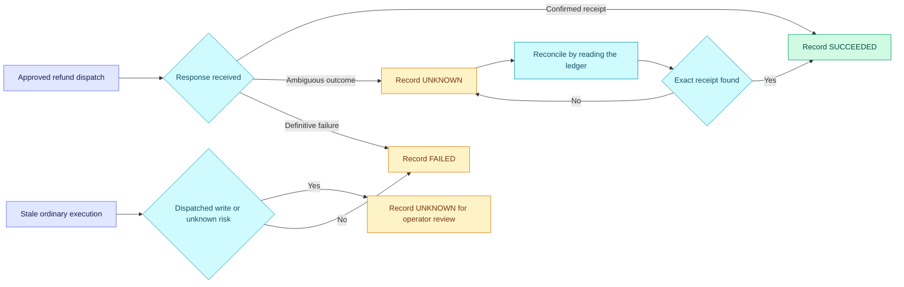

The reconciler does not replay writes. Expired or rejected approvals and revoked grants block dispatch. Quota unavailability blocks writes. Interrupted crawl jobs can be reclaimed after their lease expires. Interrupted evaluation runs rebuild deterministic inputs from their stored configuration. [Operational procedures](runbook.md#diagnose-startup-and-dependency-failures)

## Local deployment

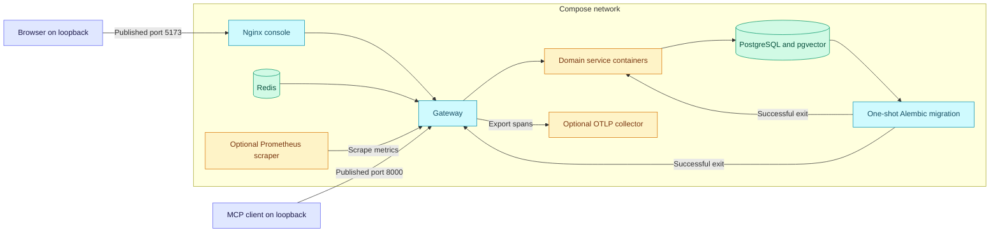

The gateway joins the Compose network and publishes its HTTP port on loopback. PostgreSQL, Redis, and domain services have no host port bindings. The optional embedding files mount read-only. The [runbook](runbook.md) covers bootstrap and faults.

## Technology choices

| Technology | Engineering rationale |
|---|---|
| FastAPI and FastMCP | Typed HTTP contracts and native MCP Streamable HTTP share one invocation path. |
| PostgreSQL and Alembic | Transactions coordinate catalog, decision, and execution state. Migrations declare domain roles and schema evolution. |
| PostgreSQL text search and pgvector | Weighted lexical rank and exact cosine ranking use the same scoped relational dataset. |
| Redis | Shared quota counters keep rate-limit state separate from the transactional ledger. |
| LangGraph | Bounded scripted agent steps share the gateway and persist checkpoints without depending on a model provider. |
| Protobuf and gRPC | Checked-in descriptors define the IT contract and support reproducible stub generation. |
| React, TypeScript, Vite, and Nginx | A typed console builds to static assets. Nginx serves it and forwards same-origin API requests. |
| Model2Vec | The pinned CPU model provides local semantic retrieval without an inference service dependency. |

See the [ADR index](adr/README.md) for the tradeoffs and accepted boundaries.

## Agent profiles and governance

Tool discovery, direct schema access, invocation, and approval use the same authorization predicate. The profile bounds services, the active pointer selects the contract, and enabled matching deny rules remove the candidate. Rules are scoped to one principal, tool, and sandbox customer. Resuming approved work checks the requester's current access.

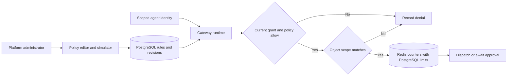

Support, Finance, IT, and HR run deterministic LangGraph scenarios. The worker persists ordered results and execution references, stops on a failure, and resumes an IT workflow only after a terminal approval outcome. Approved restarts update sandbox state and create an idempotent receipt. HR uses locked allowance updates and rejects overlaps. Analytics reads scoped Payments projections and writes reports into its own schema. [ADR 0006](adr/0006-domain-governance-and-scripted-agents.md)

## Release provider evaluation

The opt-in release runner exchanges synthetic task text and authorized contract metadata with a loopback Ollama process. The authenticated gateway retains enforcement over discovery, schema lookup, and execution.

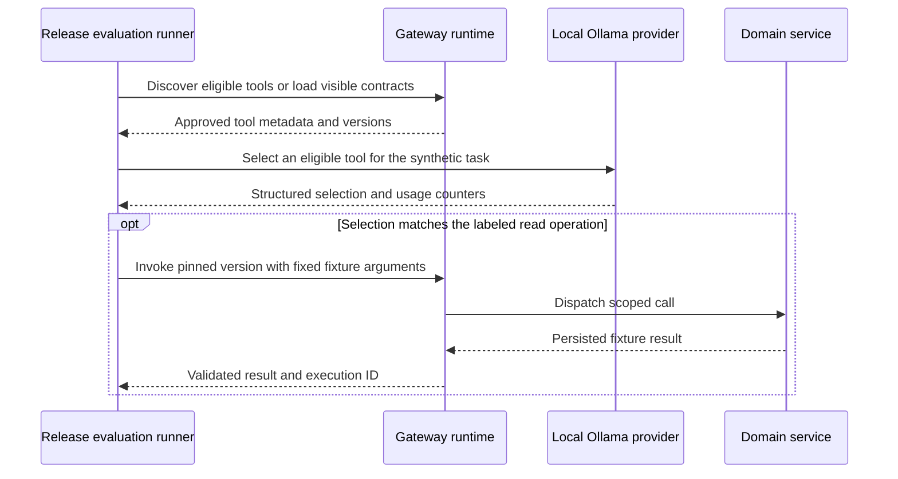

[Release methodology and evidence](release-validation.md)

## OpenAI Playground

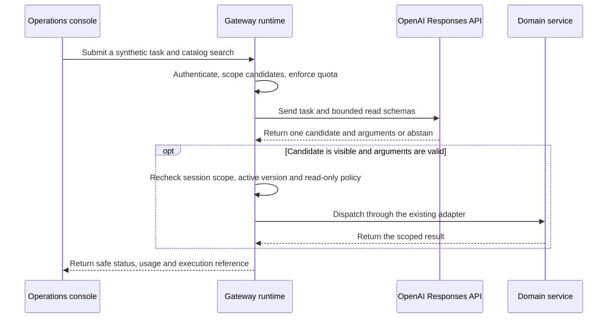

OpenAI selection is an opt-in gateway route. A fixed model, request deadline, shortlist size, and output token limit bound each call. The gateway sends no authorization header from its caller and keeps domain results outside the provider request. Estimates use configured list rates.
